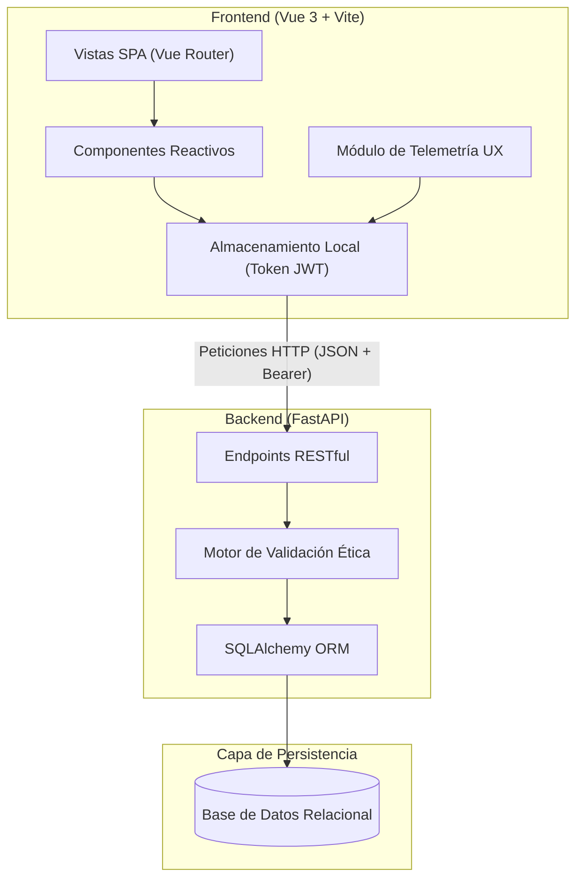

# 🎓 Presupuesto Estudiantil — Sistema de Gestión Financiera y Control Ético

> **Proyecto de Interacción Humano-Computador (IHC)**  
> Plataforma web diseñada para que estudiantes universitarios gestionen sus ingresos, gastos, metas de ahorro y límites mensuales con principios de usabilidad, accesibilidad (WCAG 2.1 AA), heurísticas de Nielsen y diseño ético (libre de *Dark Patterns*).

---

## 🌐 Enlaces del Proyecto

- **Aplicación Web Desplegada:** [https://presupuesto-estudiantil-frontend.onrender.com](https://presupuesto-estudiantil-frontend.onrender.com)
- **Diseño y Prototipo en Figma:** [Ver Prototipo en Figma](https://www.figma.com/design/MaFkJFpWeGd335TtbzHUKM)

---

## 📊 Informes Técnicos y Entregables del Fork

Los informes técnicos oficiales generados para la evaluación del segundo proyecto de Interacción Humano-Computador se encuentran disponibles directamente en la raíz del repositorio:

| Documento | Descripción | Cobertura / Métrica |
|---|---|:---:|
| 📄 **[INFORME_ACCESIBILIDAD.md](./PROYECTO2-IHC/INFORME_ACCESIBILIDAD.md)** | Auditoría integral de accesibilidad web (WCAG 2.1 AA), certificación de contrastes cromáticos ($\ge 4.5:1$ texto normal, $\ge 3:1$ interfaz), atributos ARIA semánticos y 6 reportes HTML interactivos de Google Lighthouse. | **100/100 Lighthouse** ✅ |
| 🧪 **[INFORME_PRUEBAS_E2E_COBERTURA.md](./PROYECTO2-IHC/INFORME_PRUEBAS_E2E_COBERTURA.md)** | Informe exhaustivo de la suite de pruebas automatizadas End-to-End (E2E) con Playwright, inventario individual de las 32 pruebas, matriz de cobertura del 100% de features del fork y log de consola. | **32/32 Pasadas (100%)** ✅ |
| 🎨 **[MATRIZ_COMPONENTES_TOKENS_FIGMA.md](./PROYECTO2-IHC/MATRIZ_COMPONENTES_TOKENS_FIGMA.md)** | Matriz de trazabilidad y consistencia visual entre los Design Tokens de Figma (colores, tipografía, bordes, estados) y su implementación en `src/tokens.css` y vistas de Vue 3. | **Tokens Sincronizados** ✅ |
| 📋 **[HISTORIAL_GIT.md](./PROYECTO2-IHC/HISTORIAL_GIT.md)** | Historial completo de commits desde el fork (47 commits propios organizados por hito/tarea, desde el análisis inicial hasta el despliegue final). | **47 commits documentados** ✅ |

---

## 📑 Tabla de Contenidos

1. [Informes Técnicos y Entregables del Fork](#-informes-técnicos-y-entregables-del-fork)
2. [Arquitectura del Sistema](#-arquitectura-del-sistema)
3. [Estructura del Proyecto](#-estructura-del-proyecto)
4. [Flujos Principales de la Aplicación](#-flujos-principales-de-la-aplicación)
5. [Requisitos Previos](#-requisitos-previos)
6. [Instalación y Ejecución Local](#-instalación-y-ejecución-local)
   - [Paso 1: Backend (FastAPI)](#paso-1-backend-fastapi)
   - [Paso 2: Frontend (Vue 3 + Vite)](#paso-2-frontend-vue-3--vite)
   - [Ejecución Rápida en Windows (.bat)](#ejecución-rápida-en-windows-bat)
7. [Configuración de Entorno (.env)](#-configuración-de-entorno-env)
8. [Pruebas Automatizadas y QA](#-pruebas-automatizadas-y-qa)
   - [Pruebas Unitarias del Backend (Pytest)](#pruebas-unitarias-del-backend-pytest)
   - [Pruebas E2E y Accesibilidad (Playwright + Axe-Core)](#pruebas-e2e-y-accesibilidad-playwright--axe-core)
9. [Documentación y Evidencias por Tarea](#-documentación-y-evidencias-por-tarea)
10. [Historial de Git](#-historial-de-git)

---

## 🏛 Arquitectura del Sistema

La plataforma está construida bajo una arquitectura cliente-servidor desacoplada:



### Stack Tecnológico

- **Frontend:** Vue 3, Vue Router 4, Vite 5, CSS moderno y accesible.
- **Backend:** FastAPI, Python 3.12, Uvicorn, SQLAlchemy 2.0, Pydantic v2, PyJWT.
- **Base de Datos:** PostgreSQL (con soporte de respaldo local SQLite para desarrollo).
- **Pruebas y Calidad:** Playwright, Axe-Core (WCAG 2.1 AA), Pytest.

---

## 📂 Estructura del Proyecto

```
segundo_proyecto_fork/
├── INFORME_ACCESIBILIDAD.md           # Informe de accesibilidad WCAG 2.1 AA y Lighthouse
├── INFORME_PRUEBAS_E2E_COBERTURA.md   # Informe de 32 pruebas E2E (100% cobertura)
├── MATRIZ_COMPONENTES_TOKENS_FIGMA.md # Trazabilidad tokens Figma a CSS/Vue
├── HISTORIAL_GIT.md                   # Historial completo de commits desde el fork (47 commits)
├── README.md                          # Documentación general del repositorio
├── evidencias/                        # Evidencias de auditoría Lighthouse y capturas
│   └── Lighthouse/                    # Reportes HTML interactivos de accesibilidad
│
├── PROYECTO2-IHC/
│   ├── iniciar_backend.bat            # Script para iniciar Backend en Windows
│   ├── iniciar_frontend.bat           # Script para iniciar Frontend en Windows
│   ├── package.json                   # Dependencias de pruebas Playwright + Axe
│   ├── playwright.config.js           # Configuración de pruebas E2E
│   ├── tests/                         # Suites de pruebas E2E y accesibilidad (18 archivos, 32 tests)
│   │   ├── accesibilidad.spec.js      # Auditoría WCAG 2.1 AA (3 tests)
│   │   ├── login.spec.js              # Pruebas de acceso (2 tests)
│   │   ├── registrar-gasto.spec.js    # Flujo de gastos (2 tests)
│   │   ├── editar-eliminar.spec.js    # Edición y eliminación (3 tests)
│   │   ├── limite-categoria-mes.spec.js # Límites por categoría y recálculo (2 tests)
│   │   ├── limite-mensual.spec.js     # Reglas de límite de gastos (2 tests)
│   │   ├── tarea8-metas-ahorro.spec.js # Pruebas de metas de ahorro (1 test)
│   │   ├── tarea9-aviso-limite-y-telemetria.spec.js # Aviso y analítica (1 test)
│   │   └── tarea10-portabilidad-y-baja-cuenta.spec.js # Baja ética y portabilidad (1 test)
│   │
│   ├── docs/                          # Documentación académica y de diseño
│   │   ├── INFORME_ACCESIBILIDAD.md   # Réplica del informe de accesibilidad
│   │   ├── INFORME_PRUEBAS_E2E_COBERTURA.md # Réplica del informe de pruebas E2E
│   │   ├── issue-limite-mensual.md    # Especificación de límites
│   │   ├── evidencias/                # Capturas y respaldos de ejecución
│   │   └── tarea6.md, tarea7.md...    # Reportes detallados por entrega
│   │
│   └── PRESUPUESTO ESTUDIANTIL/
│       ├── BASE DE DATOS/
│       │   ├── schema.sql             # Estructura de tablas y restricciones
│       │   └── seed.sql               # Categorías iniciales y datos de prueba
│       │
│       ├── BACKEND/
│       │   ├── main.py                # Entrada principal FastAPI y CORS
│       │   ├── database.py            # Configuración de base de datos
│       │   ├── models.py              # Modelos de base de datos
│       │   ├── schemas.py             # Validaciones Pydantic
│       │   ├── auth.py                # Autenticación y tokens JWT
│       │   ├── reglas_presupuesto.py  # Reglas de negocio financieras
│       │   ├── requirements.txt       # Librerías de Python
│       │   ├── .env.example           # Plantilla de variables de entorno
│       │   ├── routers/               # Rutas de la API (usuarios, movimientos, etc.)
│       │   └── tests/                 # Pruebas unitarias con Pytest
│       │
│       └── FRONTEND/
│           ├── package.json           # Dependencias de Vue 3
│           ├── vite.config.js         # Configuración del empaquetador
│           └── src/
│               ├── router/index.js    # Navegación y protección de rutas
│               └── views/             # Vistas de la aplicación
│                   ├── HomeView.vue        # Inicio y botón de Demo
│                   ├── LoginView.vue       # Iniciar sesión
│                   ├── RegisterView.vue    # Crear cuenta
│                   ├── RecuperarView.vue   # Recuperar contraseña (OTP)
│                   ├── MovimientosView.vue # Dashboard principal
│                   ├── HistorialView.vue   # Historial mensual y filtros
│                   ├── CuentaView.vue      # Perfil, portabilidad y baja ética
│                   └── AnaliticaView.vue   # Métricas y telemetría UX
```

---

## 🔄 Flujos Principales de la Aplicación

1. **Acceso y Modo Demostración:**
   - Registro de usuario e inicio de sesión con tokens seguros.
   - **Acceso Demo:** Botón en la portada para ingresar con cuenta precargada de prueba (`estudiante@demo.com` / `estudiante123`) sin necesidad de registrarse.
   - Recuperación de contraseña en dos pasos mediante código de verificación.

2. **Registro de Movimientos y Prevención:**
   - Registro de ingresos y gastos categorizados con fechas y opción de recurrencia.
   - Estado de pago (`Pendiente` o `Pagado`) con cambio de estado en un clic.
   - Advertencia ética previa si un nuevo gasto excede el límite disponible.

3. **Límite Mensual y Presupuesto por Categoría:**
   - Establecimiento de un tope de gasto mensual (la regla prohíbe fijar un límite menor a lo ya gastado en el mes).
   - Barra de consumo dinámico con cambio de color semántico según el nivel de uso.
   - Presupuestos independientes por categoría con avisos preventivos al 80%.

4. **Metas de Ahorro:**
   - Creación de alcancías virtuales con montos y fechas límite.
   - Asignación, transferencia y retiro de fondos con validación de saldo disponible.

5. **Historial Mensual:**
   - Navegación temporal mes a mes con balances resumidos (Ingresos, Gastos y Balance neto).
   - Filtros instantáneos por tipo de transacción (Todos, Ingresos, Gastos).

6. **Portabilidad y Baja Ética (Tarea 10):**
   - Descarga del historial en formato abierto (JSON / CSV).
   - Cancelación de cuenta directa y transparente, sin patrones engañosos (*Dark Patterns*).

7. **Telemetría y Analítica UX (`/analitica`):**
   - Panel de embudos de conversión y registro de puntos de fricción o bloqueos de seguridad.

---

## ⚙️ Requisitos Previos

- **Node.js** v18 o superior.
- **Python** 3.10 o superior.
- **Git**.

---

## 🚀 Instalación y Ejecución Local

Para levantar el proyecto en tu computadora, abre **dos terminales**:

### Paso 1: Backend (FastAPI)

1. En la primera terminal, ingresa a la carpeta del backend:
   ```bash
   cd "PROYECTO2-IHC/PRESUPUESTO ESTUDIANTIL/BACKEND"
   ```
2. Crea el entorno virtual de Python:
   ```bash
   python -m venv venv
   ```
3. Activa el entorno virtual:
   - **En Windows:**
     ```powershell
     .\venv\Scripts\activate
     ```
   - **En Linux / macOS:**
     ```bash
     source venv/bin/activate
     ```
4. Instala las dependencias:
   ```bash
   pip install -r requirements.txt
   ```
5. Copia la plantilla de variables de entorno:
   ```bash
   copy .env.example .env
   ```
   *(Si no se configura una base de datos externa, el sistema iniciará automáticamente con almacenamiento local).*
6. Inicia el servidor backend:
   ```bash
   python -m uvicorn main:app --reload --port 8000
   ```

### Paso 2: Frontend (Vue 3 + Vite)

1. En la segunda terminal, ingresa a la carpeta del frontend:
   ```bash
   cd "PROYECTO2-IHC/PRESUPUESTO ESTUDIANTIL/FRONTEND"
   ```
2. Instala las dependencias del proyecto:
   ```bash
   npm install
   ```
3. Inicia el servidor de desarrollo:
   ```bash
   npm run dev
   ```
4. Abre tu navegador en:
   ```
   http://localhost:5173
   ```

### Ejecución Rápida en Windows (.bat)

Si estás en Windows, puedes iniciar ambos servicios con los scripts incluidos en `PROYECTO2-IHC/`:
- Doble clic en **`PROYECTO2-IHC/iniciar_backend.bat`**
- Doble clic en **`PROYECTO2-IHC/iniciar_frontend.bat`**

---

## 🔐 Configuración de Entorno (.env)

El archivo `.env` del backend se genera a partir de `.env.example`:

- **DATABASE_URL:** Cadena de conexión a tu base de datos relacional.
- **SECRET_KEY:** Clave para la firma y cifrado de los tokens de sesión.
- **ALGORITHM:** Algoritmo de firmado de tokens (por defecto `HS256`).
- **SMTP_HOST / SMTP_USER / SMTP_PASSWORD:** Configuración opcional para envío de correos de recuperación. Si se omiten, el código OTP de verificación se muestra en la consola del backend para facilitar las pruebas locales.

---

## 🧪 Pruebas Automatizadas y QA

### Pruebas Unitarias del Backend (Pytest)
Valida las reglas de límite, transacciones y cálculos financieros:

```bash
cd "PROYECTO2-IHC/PRESUPUESTO ESTUDIANTIL/BACKEND"
pytest -v -p no:warnings
```

### Pruebas E2E y Accesibilidad (Playwright + Axe-Core)
Ejecuta la suite completa de 32 pruebas automatizadas y la verificación de accesibilidad:

```bash
cd "PROYECTO2-IHC"
pnpm test:e2e
```
*Para ejecutarlas con el listado detallado en tiempo real en consola:*
```bash
pnpm test:e2e --reporter=list
```
*Para abrir el reporte interactivo HTML:*
```bash
pnpm exec playwright show-report
```

> 📖 **Informe Completo de Pruebas:** Para consultar el detalle de las 32 pruebas ejecutadas, la matriz de cobertura del 100% y la salida de consola, revisa **[INFORME_PRUEBAS_E2E_COBERTURA.md](./PROYECTO2-IHC/INFORME_PRUEBAS_E2E_COBERTURA.md)**.

---

## 📚 Documentación y Evidencias por Tarea

### Informes Principales del Proyecto (Raíz)
- 📄 **[INFORME_ACCESIBILIDAD.md](./PROYECTO2-IHC/INFORME_ACCESIBILIDAD.md)**: Certificación de Accesibilidad WCAG 2.1 AA, contraste matemático de colores y reportes HTML de Lighthouse (Puntaje 100/100).
- 🧪 **[INFORME_PRUEBAS_E2E_COBERTURA.md](./PROYECTO2-IHC/INFORME_PRUEBAS_E2E_COBERTURA.md)**: Auditoría formal de las 32 pruebas E2E de Playwright y 100% de cobertura del código incorporado en el fork.
- 🎨 **[MATRIZ_COMPONENTES_TOKENS_FIGMA.md](./PROYECTO2-IHC/MATRIZ_COMPONENTES_TOKENS_FIGMA.md)**: Trazabilidad y correspondencia de Design Tokens de Figma con `src/tokens.css` y componentes de Vue 3.

- 📄 **[Presupuesto_Estudiantil_Informe.pdf](./PROYECTO2-IHC/docs/Presupuesto_Estudiantil_Informe.pdf)**: Informe completo del proyecto (PDF).
- 📊 **[Diapositiva Presupuesto Estudiantil (PDF)](./PROYECTO2-IHC/docs/Diapositiva_Presupuesto_estudiantil.pdf)**
- 📊 **[Presentación Canva](https://canva.link/qjf4r8q3cczsg66)**
- 🎥 **[Video explicativo del sistema Presupuesto Estudiantil](https://youtu.be/DqvCtR4v4oM)**

### Reportes por Tareas Específicas
Las especificaciones, heurísticas de Nielsen y reportes de laboratorio se encuentran en `PROYECTO2-IHC/docs/`:

- [docs/issue-limite-mensual.md](file:///c:/Users/HP/Desktop/Universidad/Interaccion%20Hombre%20Computador/segundo_proyecto_fork/PROYECTO2-IHC/docs/issue-limite-mensual.md): Regla de negocio de límite de gastos y criterios de aceptación.
- [docs/tarea-6.md](file:///c:/Users/HP/Desktop/Universidad/Interaccion%20Hombre%20Computador/segundo_proyecto_fork/PROYECTO2-IHC/docs/tarea-6.md): Validación de límites y presupuesto por categoría.
- [docs/tarea-7.md](file:///c:/Users/HP/Desktop/Universidad/Interaccion%20Hombre%20Computador/segundo_proyecto_fork/PROYECTO2-IHC/docs/tarea-7.md): Estados dinámicos y recálculo presupuestario.
- [docs/tarea-8.md](file:///c:/Users/HP/Desktop/Universidad/Interaccion%20Hombre%20Computador/segundo_proyecto_fork/PROYECTO2-IHC/docs/tarea-8.md): Metas de ahorro y transferencias entre objetivos.
- [docs/tarea-9.md](file:///c:/Users/HP/Desktop/Universidad/Interaccion%20Hombre%20Computador/segundo_proyecto_fork/PROYECTO2-IHC/docs/tarea-9.md): Telemetría, embudos y avisos preventivos.
- [docs/tarea-10.md](file:///c:/Users/HP/Desktop/Universidad/Interaccion%20Hombre%20Computador/segundo_proyecto_fork/PROYECTO2-IHC/docs/tarea-10.md): Portabilidad de datos y cancelación ética.
- [docs/clase-22.md](file:///c:/Users/HP/Desktop/Universidad/Interaccion%20Hombre%20Computador/segundo_proyecto_fork/PROYECTO2-IHC/docs/clase-22.md): Solución a patrones oscuros (*Dark Patterns*).

---

## 📋 Historial de Git

El historial completo de commits del fork (47 commits propios, organizados por hito/tarea) está documentado en:

📋 **[HISTORIAL_GIT.md](./PROYECTO2-IHC/HISTORIAL_GIT.md)**

| Dato | Valor |
|---|---|
| Punto de fork | `ada8f40` — 2026-10-27 |
| Commits propios | 47 commits |
| Período | 2026-10-27 → 2026-11-18 |
| Hitos cubiertos | 13 (Tareas 5–10 + Clases 17, 20, 21, 22, 23) |
| Último commit | `cc46ea1` — tokens de figma en el codigo |
