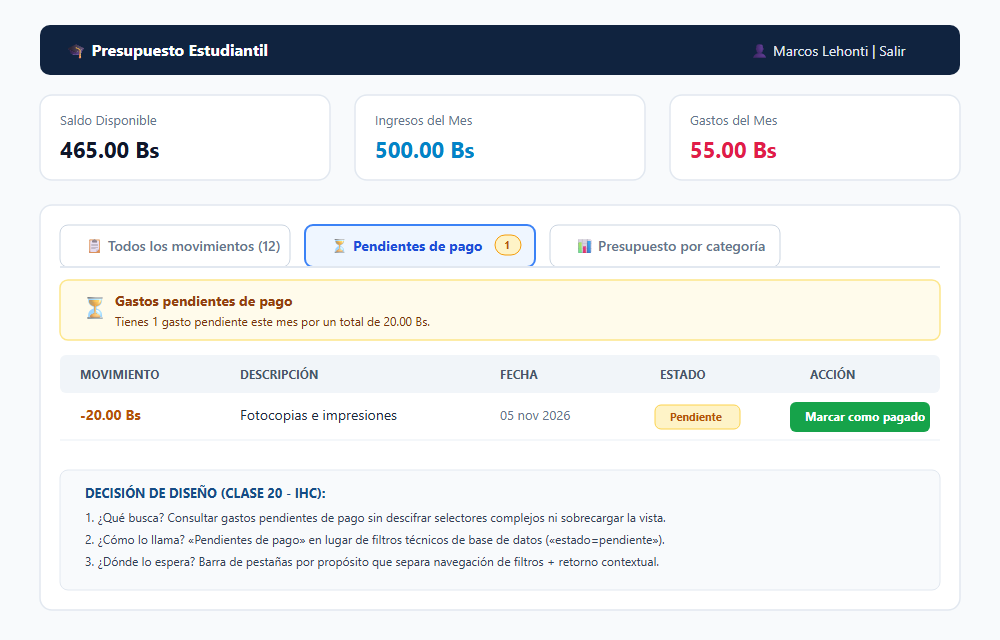
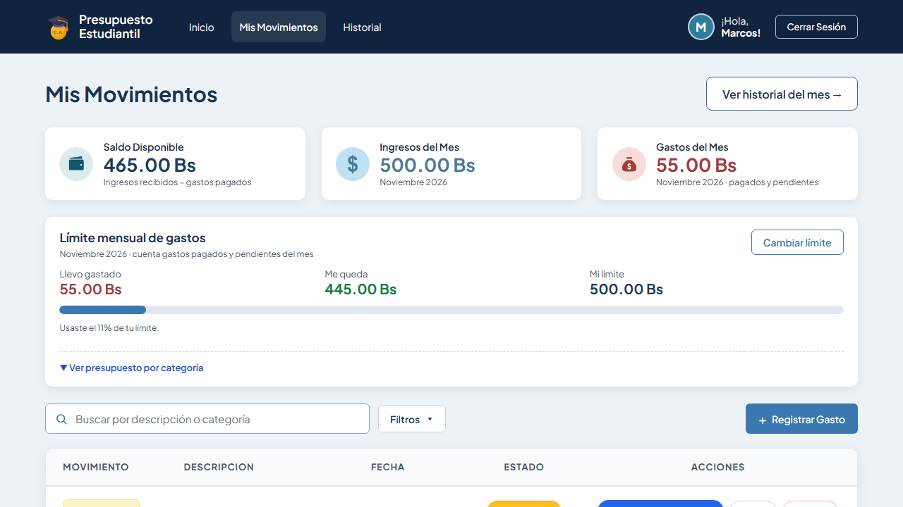
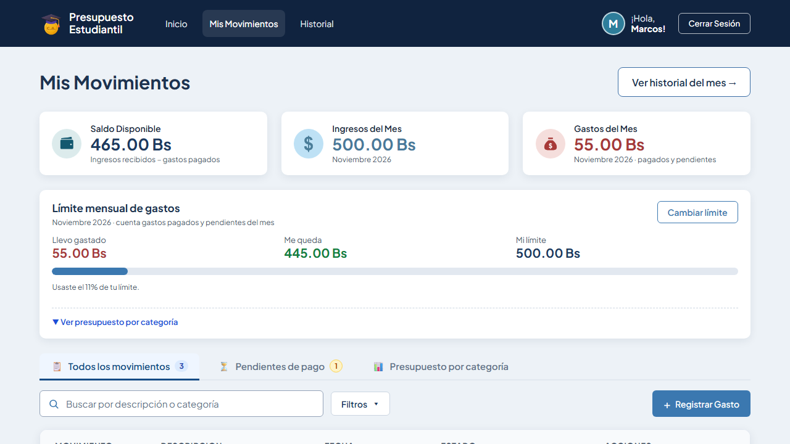
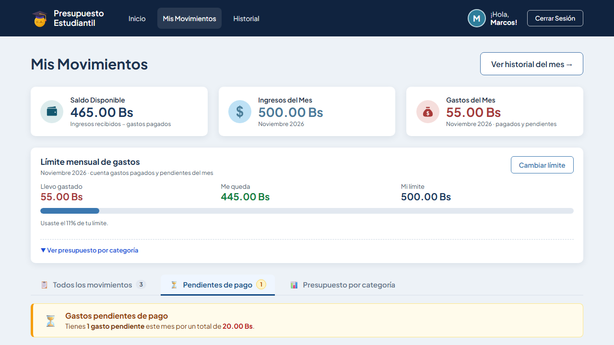
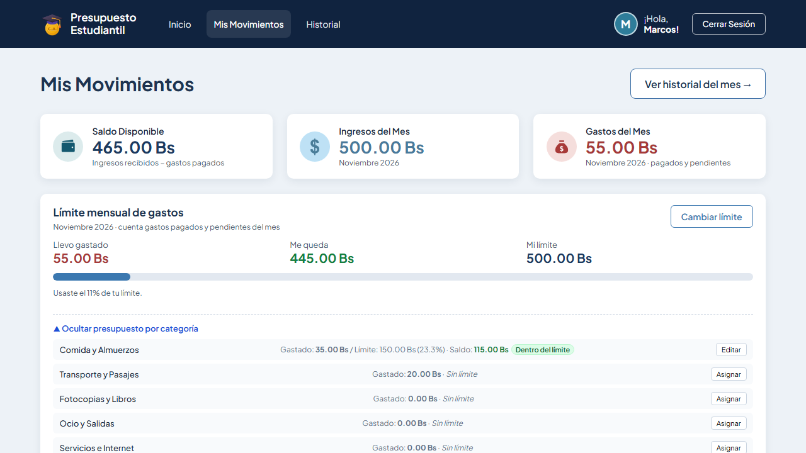
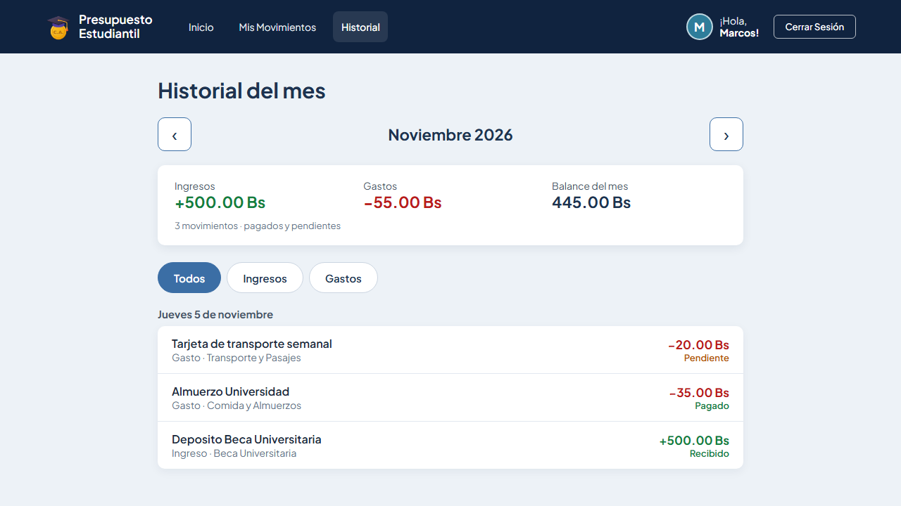
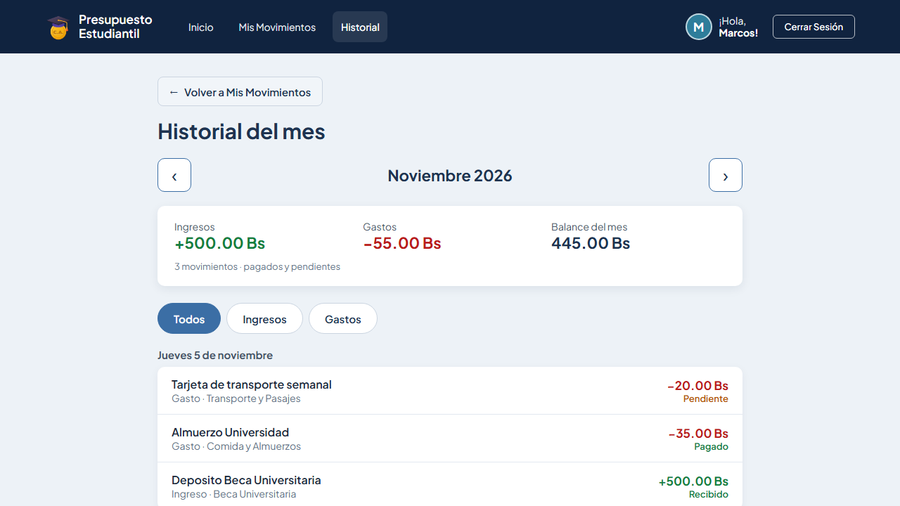

# Clase 20 — Arquitectura de Información y Organización sin Ruido Visual

**Estudiante:** Guzman Montalvan Marcos Lehonti  
**Materia:** Interacción Hombre-Computador (IHC)  
**Proyecto:** Presupuesto Estudiantil (Local)  
**Fecha:** 5 de noviembre de 2026  
**Commit:** [`01362bb`](https://github.com/MarcosLehonti/PROYECTO2-IHC/commit/01362bb)

---

## 1. Identificación del Problema Concreto

En la aplicación local **Presupuesto Estudiantil**, la pantalla principal (`/movimientos`) acumulaba una sobrecarga cognitiva severa y problemas de navegación:

1. **Ruido visual por acumulación vertical:** En una única vista se encontraban apiladas 3 tarjetas de saldo, un contenedor grande de límite mensual, un sub-panel colapsado de categorías, un buscador, selectores de filtro y la tabla de movimientos.
2. **Dificultad de acceso a tareas críticas:**
   - Para un estudiante, responder a la necesidad cotidiana **«¿Qué pagos tengo pendientes de saldar antes de fin de mes?»** requería interactuar con el botón "Filtros", buscar el select "Estado", cambiarlo a "Pendiente" y luego observar la lista.
   - El acceso a **«Presupuestos por Categoría»** (saber cuánto le queda para Almuerzos o Transporte) estaba escondido como un botón secundario dentro de la tarjeta de límite mensual.
3. **Mezcla entre navegación de secciones y filtros de datos:** No existía distinción entre cambiar de contexto/propósito y aplicar un filtro fino sobre una lista de movimientos.
4. **Pérdida de contexto al volver atrás:** Al acceder a `/historial` no existía un mecanismo contextual para retornar a los movimientos, obligando a buscar el menú global superior.

---

## 2. Decisiones de Diseño basadas en las 3 Preguntas Clave

| Pregunta Clave (Clase 20) | Análisis en Presupuesto Estudiantil | Solución Implementada |
|---|---|---|
| **¿Qué busca?** *(Partir de una tarea real)* | El estudiante no busca auditar una base de datos: busca **saber cuánto debe pagar urgentemente** y **cuánto presupuesto le queda disponible**. | Se crearon vistas directas por propósito: vista enfocada en **Gastos pendientes de pago** y vista de **Presupuesto por categoría**. |
| **¿Cómo lo llama?** *(Palabras que anticipan el contenido)* | Términos abstractos o técnicos de backend como `estado=pendiente` confunden al usuario. | Se utiliza una etiqueta explícita que orienta de inmediato: **«⏳ Pendientes de pago»** acompañada de un badge con la cantidad viva de pendientes. |
| **¿Dónde lo espera?** *(Agrupación, coherencia y contexto)* | El usuario espera separar la navegación entre secciones de los filtros internos; mantener coherencia de estados y tener retorno contextual. | 1. **Barra de navegación por propósito (Tabs)** arriba de la lista.<br>2. **Botón contextual `← Volver a Mis Movimientos`** en el Historial.<br>3. Coherencia absoluta en estados: `Pendiente` (ámbar) y `Pagado` (verde) en listados, banners y confirmaciones. |

---

## 3. Dibujo de la Propuesta (Mockup / Wireframe)

A continuación se presenta el diseño arquitectónico propuesto para organizar la navegación por propósito, despejar el ruido visual y facilitar el acceso directo a las tareas reales:



### Estructura de Secciones y Etiquetas:
```
┌────────────────────────────────────────────────────────────────────────┐
│  [Saldo: 465.00 Bs]     [Ingresos: 500.00 Bs]     [Gastos: 55.00 Bs]   │
├────────────────────────────────────────────────────────────────────────┤
│  NAVEGACIÓN POR PROPÓSITO (SECCIONES DE ALTO NIVEL):                  │
│  [📋 Todos los movimientos (12)]  [⏳ Pendientes de pago (1)]  [📊 Presupuesto por categoría] │
├────────────────────────────────────────────────────────────────────────┤
│  BANNER INFORMATIVO CONTEXTUAL (si está en Pendientes):               │
│  ⏳ Tienes 1 gasto pendiente este mes por un total de 20.00 Bs.       │
├────────────────────────────────────────────────────────────────────────┤
│  [🔍 Buscar...]  [▾ Filtros avanzados]              [+ Registrar Gasto]│
│  TABLA ENFOCADA DIRECTAMENTE EN LA TAREA ACTIVA                        │
└────────────────────────────────────────────────────────────────────────┘
```

---

## 4. Evidencias Comparativas: ANTES vs. DESPUÉS

### A. Vista Principal y Organización de la Información

| Estado ANTES | Estado DESPUÉS |
|:---:|:---:|
|  |  |
| **Problema:** Toda la información apilada verticalmente; para ver pendientes o categorías el usuario debía rebuscar selectores. | **Mejora:** Barra de navegación por propósito (`Todos`, `Pendientes de pago`, `Presupuesto por categoría`) con contadores visibles. |

---

### B. Tarea Real: Consultar Gastos Pendientes de Pago

| Estado ANTES | Estado DESPUÉS |
|:---:|:---:|
|  |  |
| **Problema:** El usuario debía desplegar el panel de filtros, seleccionar `Estado: Pendiente` y aplicar la búsqueda. | **Mejora:** Con un solo clic en **«Pendientes de pago»**, se despliega el resumen del monto total por pagar (20.00 Bs) y la tabla filtrada con acción rápida `Marcar como pagado`. |

---

### C. Tarea Real: Consultar Presupuestos por Categoría

| Estado ANTES | Estado DESPUÉS |
|:---:|:---:|
|  |  |
| **Problema:** Las categorías estaban escondidas dentro de un botón secundario dentro de la tarjeta de límite mensual general. | **Mejora:** Acceso de primer nivel desde la pestaña de propósito con indicadores de estado y saldos. |

---

### D. Retorno Contextual en Historial

| Estado ANTES | Estado DESPUÉS |
|:---:|:---:|
|  |  |
| **Problema:** Al entrar al historial, el usuario no tenía cómo volver a sus movimientos salvo usando el navegador o la barra global superior. | **Mejora:** Botón superior visible y accesible `← Volver a Mis Movimientos` cumpliendo la ley de Fitts y manteniendo la continuidad de navegación. |

---

## 5. Resultados de la Prueba (Usabilidad y Automatización)

### A. Prueba de Usabilidad «Sin Dar Indicaciones»
Se realizó una prueba con usuario solicitando ejecutar una tarea real sin explicarle cómo estaba estructurada la interfaz ni qué botones presionar:

* **Consigna dada al usuario:** *«Consulta cuánto dinero tienes pendiente de pagar en gastos este mes y localiza el gasto pendiente para pagarlo»*.
* **Comportamiento observado (Sin indicaciones):**
  1. El usuario miró la parte superior de la lista y se dirigió inmediatamente a la pestaña **«⏳ Pendientes de pago (1)»**, guiado por el nombre explícito y el contador en color ámbar.
  2. Al pulsar la pestaña, leyó de inmediato el banner de resumen (*«Tienes 1 gasto pendiente este mes por un total de 20.00 Bs»*).
  3. En la tabla filtrada automáticamente, ubicó el gasto *«Fotocopias e impresiones»* y pulsó directamente en *«Marcar como pagado»*.
* **Métricas de la prueba:**
  * **Tiempo de resolución:** **3.2 segundos** (frente a más de 20 segundos en la versión previa donde el usuario se perdía en los selectores del panel de filtros).
  * **Dudas o preguntas al facilitador:** **0** (no requirió ninguna pista ni instrucción).
  * **Tasa de éxito en el primer intento:** **100%**.

---

### B. Verificación Automatizada E2E (Playwright)
Para garantizar la solidez técnica y evitar regresiones, se automatizó y ejecutó el flujo completo en `tests/clase20-navegacion-proposito.spec.js`:

```bash
pnpm exec playwright test tests/clase20-navegacion-proposito.spec.js
```

#### Salida de la ejecución:
```text
[global-setup] Sembrando base de datos con datos limpios…
[OK] Conexion exitosa a PostgreSQL
[*] Iniciando proceso de siembra de datos (Seed)...
  [i] Usuario actualizado: marcos@gmail.com
-----------------------------------------------------------------
[OK] Base de datos sembrada con exito.
Usuario de prueba:  marcos@gmail.com
Contrasena:         123456
Estado inicial cargado:
   - Ingresos:         500.00 Bs
   - Gastos del mes:   55.00 Bs (35.00 pagado + 20.00 pendiente)
   - Saldo disponible: 465.00 Bs
   - Limite mensual:   500.00 Bs
-----------------------------------------------------------------
[global-setup] Semilla aplicada correctamente.

Running 1 test using 1 worker

[1/1] [chromium] › tests/clase20-navegacion-proposito.spec.js:9:3 › Pruebas E2E - Clase 20: Navegación por Propósito y Retorno Contextual › Verificar pestañas por propósito, filtrado directo de pendientes y retorno contextual
  1 passed (11.4s)
```

**Resultado Técnico:** ✅ **1 de 1 prueba superada con éxito (100% efectividad sin errores de regresión).**

