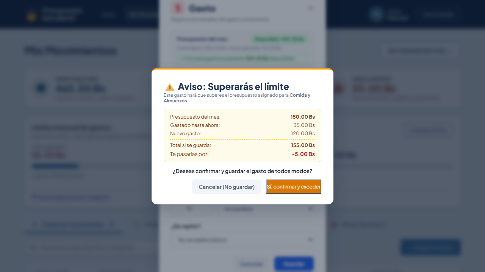
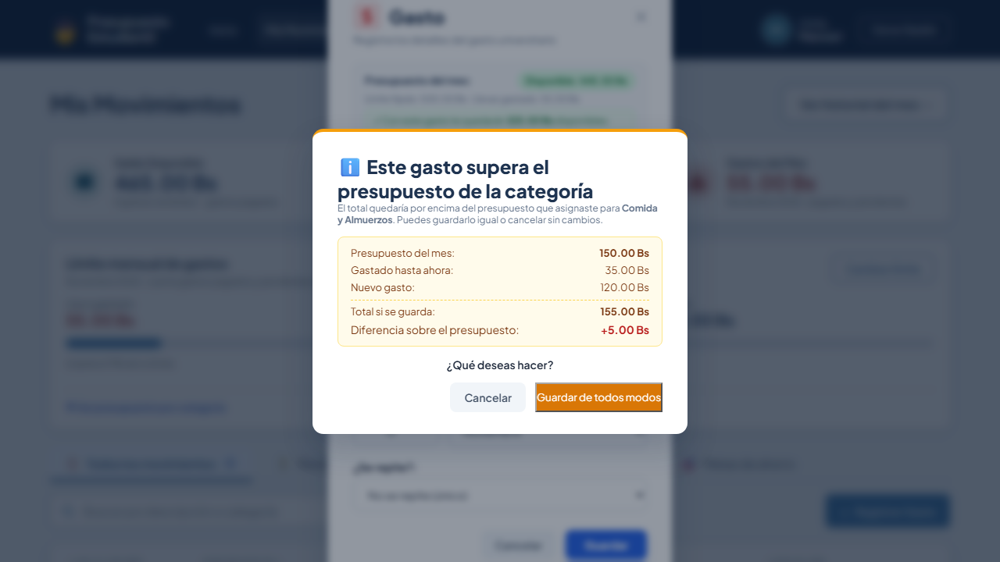

# CLASE 22 - Patrones Oscuros

**Integrantes:** Guzman Montalvan Marcos Lehonti  
**Modalidad:** sin IA  
**Fecha:** 2026-11-12  

---

## #1 PATRÓN ENCONTRADO

- **Tipo (de los seis):** Confirmación con culpa / Aviso que culpa al gastar (Confirmshaming)
- **Principio vulnerado:** NIELSEN 3: CONTROL Y LIBERTAD (Ataca las confirmaciones con culpa)
- **Dónde:** Pantalla de Dashboard Estudiantil (`/movimientos`) - Modal de advertencia antes de registrar o editar un gasto que supera el límite de categoría
- **Archivo:** `PRESUPUESTO ESTUDIANTIL/FRONTEND/src/views/MovimientosView.vue`
- **Líneas:** 934 a 972

---

## #2 ANTES

### Captura


### Fragmento de Código (Antes)
```html
<!-- Modal: Aviso antes de superar límite por categoría (Tarea 9) -->
<div v-if="avisoExcesoVisible && infoAvisoExceso" class="modal-overlay" @click.self="cancelarAvisoExceso">
  <div class="modal-card dashboard-modal-card modal-aviso-limite" role="alertdialog" aria-modal="true">
    <h2 class="dashboard-titulo">⚠️ Aviso: Superarás el límite</h2>
    <p class="meta-subetiqueta">
      Este gasto hará que superes el presupuesto asignado para <strong>{{ infoAvisoExceso.categoria }}</strong>.
    </p>

    <div class="desglose-aviso-caja">
      <div class="fila-desglose">
        <span>Presupuesto del mes:</span>
        <strong>{{ infoAvisoExceso.limite.toFixed(2) }} Bs</strong>
      </div>
      <div class="fila-desglose">
        <span>Gastado hasta ahora:</span>
        <span>{{ infoAvisoExceso.gastadoActual.toFixed(2) }} Bs</span>
      </div>
      <div class="fila-desglose">
        <span>Nuevo gasto:</span>
        <span>{{ infoAvisoExceso.nuevoMonto.toFixed(2) }} Bs</span>
      </div>
      <div class="fila-desglose fila-total-excedido">
        <span>Total si se guarda:</span>
        <strong>{{ infoAvisoExceso.nuevoTotal.toFixed(2) }} Bs</strong>
      </div>
      <div class="fila-desglose fila-cuanto-se-pasa">
        <span>Te pasarías por:</span>
        <strong class="texto-rojo">+{{ infoAvisoExceso.exceso.toFixed(2) }} Bs</strong>
      </div>
    </div>

    <p class="pregunta-confirmacion">¿Deseas confirmar y guardar el gasto de todos modos?</p>

    <div class="dashboard-modal-actions">
      <button type="button" @click="cancelarAvisoExceso" class="btn-cancelar-modal btn-cancelar-aviso">
        Cancelar (No guardar)
      </button>
      <button type="button" @click="confirmarAvisoExceso" class="btn-confirmar-guardar btn-confirmar-exceso">
        Sí, confirmar y exceder
      </button>
    </div>
  </div>
</div>
```

**Problema identificado según la checklist de clase:**
1. **Confirmación con culpa:** El botón afirmativo obligaba al usuario a aceptar la frase culposa `"Sí, confirmar y exceder"`.
2. **Aviso que culpa al gastar:** El encabezado y el texto usaban lenguaje acusatorio: `"⚠️ Aviso: Superarás el límite"`, `"Este gasto hará que superes"` y `"Te pasarías por:"`.
3. **Falta de neutralidad:** El botón de cancelar agregaba un juicio innecesario: `"Cancelar (No guardar)"`.

---

## #3 DESPUÉS

### Captura


### Fragmento de Código (Después)
```html
<!-- Modal: Aviso antes de superar límite por categoría (Tarea 9) -->
<!-- FIX(ETICA): Se eliminó confirmación con culpa. Texto neutro, botones simétricos. Nielsen 3. -->
<div v-if="avisoExcesoVisible && infoAvisoExceso" class="modal-overlay" @click.self="cancelarAvisoExceso">
  <div class="modal-card dashboard-modal-card modal-aviso-limite" role="alertdialog" aria-modal="true">
    <h2 class="dashboard-titulo">ℹ️ Este gasto supera el presupuesto de la categoría</h2>
    <p class="meta-subetiqueta">
      El total quedaría por encima del presupuesto que asignaste para <strong>{{ infoAvisoExceso.categoria }}</strong>. Puedes guardarlo igual o cancelar sin cambios.
    </p>

    <div class="desglose-aviso-caja">
      <div class="fila-desglose">
        <span>Presupuesto del mes:</span>
        <strong>{{ infoAvisoExceso.limite.toFixed(2) }} Bs</strong>
      </div>
      <div class="fila-desglose">
        <span>Gastado hasta ahora:</span>
        <span>{{ infoAvisoExceso.gastadoActual.toFixed(2) }} Bs</span>
      </div>
      <div class="fila-desglose">
        <span>Nuevo gasto:</span>
        <span>{{ infoAvisoExceso.nuevoMonto.toFixed(2) }} Bs</span>
      </div>
      <div class="fila-desglose fila-total-excedido">
        <span>Total si se guarda:</span>
        <strong>{{ infoAvisoExceso.nuevoTotal.toFixed(2) }} Bs</strong>
      </div>
      <div class="fila-desglose fila-cuanto-se-pasa">
        <span>Diferencia sobre el presupuesto:</span>
        <strong class="texto-rojo">+{{ infoAvisoExceso.exceso.toFixed(2) }} Bs</strong>
      </div>
    </div>

    <p class="pregunta-confirmacion">¿Qué deseas hacer?</p>

    <div class="dashboard-modal-actions">
      <button type="button" @click="cancelarAvisoExceso" class="btn-cancelar-modal btn-cancelar-aviso">
        Cancelar
      </button>
      <button type="button" @click="confirmarAvisoExceso" class="btn-confirmar-guardar btn-confirmar-exceso">
        Guardar de todos modos
      </button>
    </div>
  </div>
</div>
```

- **Commit de corrección:** `fix(etica): corregir confirmacion con culpa en aviso de limite aplicando nielsen 3 control y libertad`

---

## #4 PRINCIPIO APLICADO

- **NIELSEN 3: CONTROL Y LIBERTAD**
  - **Definición de la clase:** *"Salir, cancelar y deshacer tienen que estar a mano. Ataca la salida difícil y las confirmaciones con culpa."*
  - **Pregunta para verificar de la clase:** *¿El texto es neutro?*
  - **Cómo lo cumple el después:**
    - **Neutralidad absoluta:** Se eliminó la alarma y el juicio moral. El título ahora es un aviso informativo neutro: `ℹ️ Este gasto supera el presupuesto de la categoría`.
    - **Sin culpa al confirmar:** El botón de guardar es respetuoso y directo: `Guardar de todos modos` (se quitó la palabra `exceder`).
    - **Control y libertad en la salida:** El botón de cancelación es claro y simétrico: `Cancelar`.
    - **Explicación previa y respetuosa:** La descripción explica el hecho sin juzgar al estudiante: *"El total quedaría por encima del presupuesto que asignaste... Puedes guardarlo igual o cancelar sin cambios"*.

- **NIELSEN 5: PREVENCIÓN DE ERRORES**
  - Los botones dicen exactamente lo que hacen (`Guardar de todos modos` vs `Cancelar`), sin trucos visuales ni confusión.

- **LA INTERFAZ DICE LA VERDAD**
  - Cupos, gastos y diferencias salen de datos reales y fríos, sin inventar urgencia ni culpa artificiales.

---

## #5 PRUEBA

- **Nombre del test:** `El modal de aviso de límite usa lenguaje neutro, no culpabilizador (Nielsen 3)`
- **Archivo:** `tests/clase22-dark-pattern-fix.spec.js`
- **Resultado:**
  - **Falla con el antes:** Falla al verificar que el modal no contenga `Superarás el límite`, `hará que superes`, `exceder` ni `(No guardar)`.
  - **Pasa con el después:**
    ```
    Running 1 test using 1 worker
    [1/1] [chromium] › tests/clase22-dark-pattern-fix.spec.js:16:3 › FIX(ETICA) - Clase 22: Eliminación de Confirmación con Culpa en modal de límite
      1 passed (7.8s)
    ```
  - **Suite previa intacta:** Ejecutada junto con `tests/tarea9-aviso-limite-y-telemetria.spec.js` resultando en `2 passed (28.9s)`.

---

## #6 OTROS QUE ENCONTRAMOS

Patrones observados durante el recorrido de flujos con la checklist (para futuras mejoras):
1. **Confirmación con culpa en eliminación de gasto:** En `MovimientosView.vue:918` el modal dice *"Esta acción no se puede deshacer"*, lo cual advierte sobre Nielsen 5, pero podría ofrecerse un botón de *Deshacer (Undo)* transitorio mediante toast en lugar de un bloqueo modal irreversible (Nielsen 3: Deshacer a mano).
2. **Preselección por defecto en formularios:** Al registrar movimientos nuevos, el selector de mes preselecciona automáticamente el mes actual sin advertir explícitamente si el estudiante está revisando compras pasadas diferidas.
