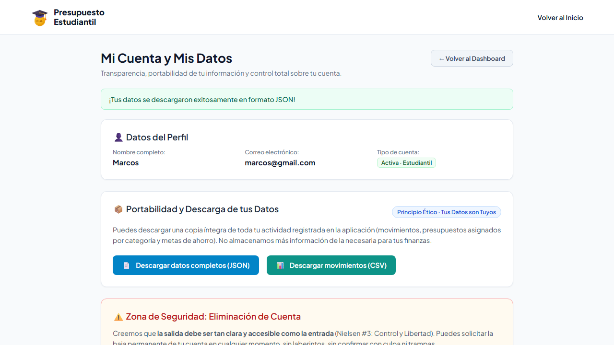
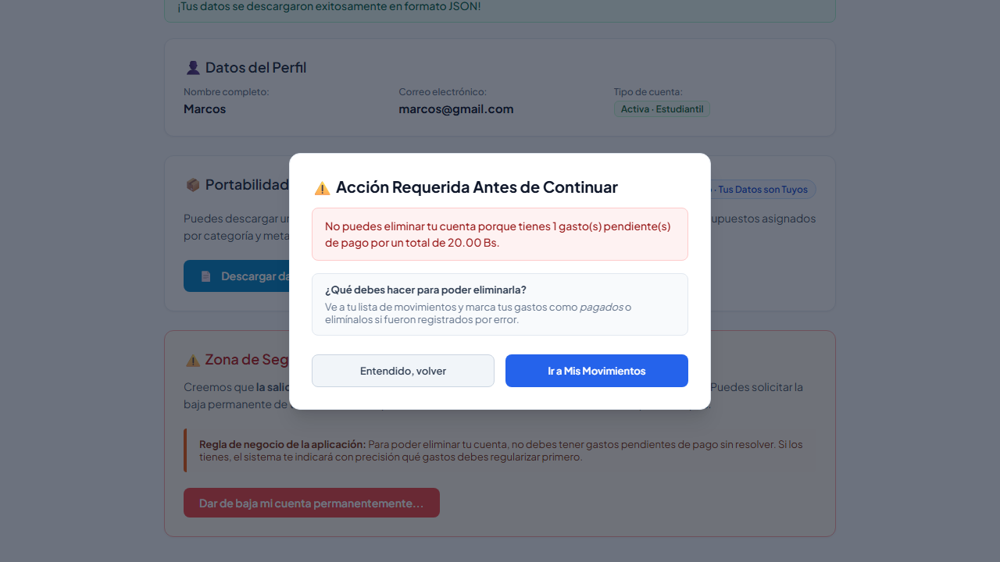
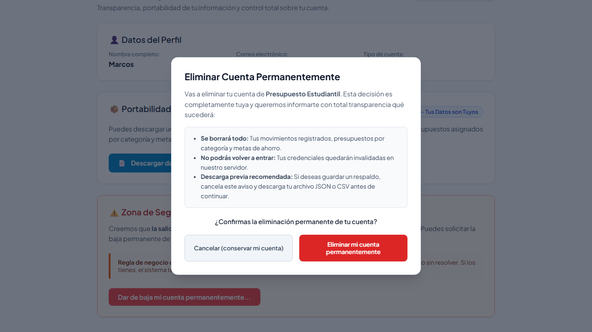
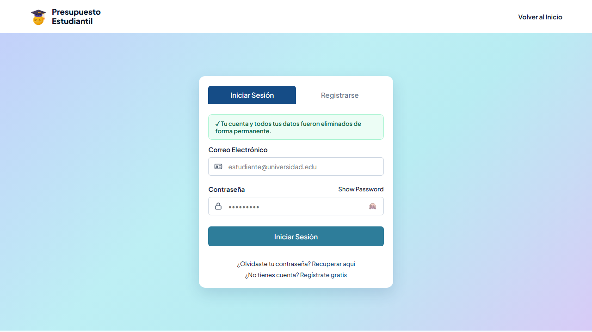
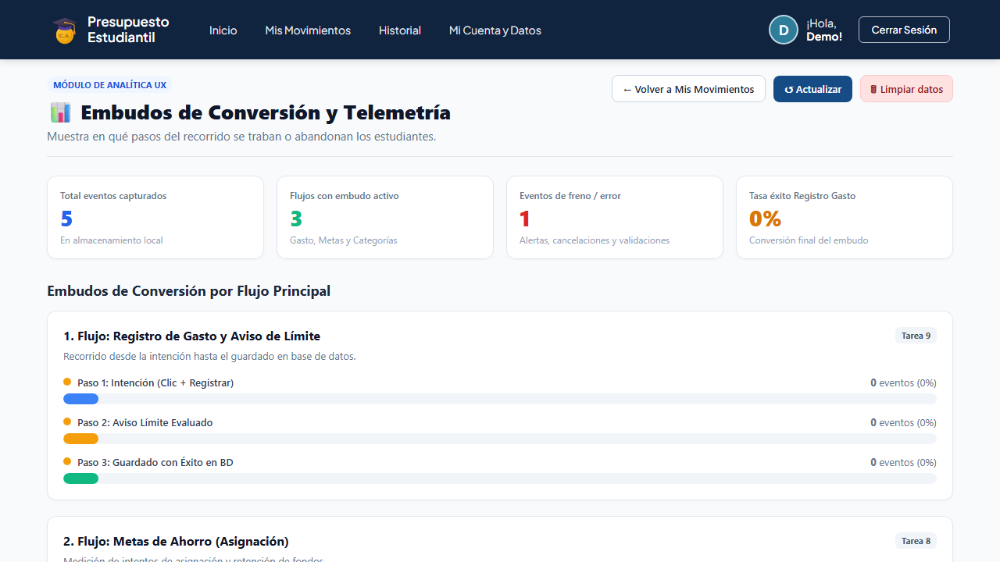

# TAREA 10 — Portabilidad de Datos, Eliminación Ética de Cuenta y Revisión de Patrones

**Integrante:** Guzmán Montalvan Marcos Lehonti  
**Fecha:** 2026-11-15  
**Repositorio:** https://github.com/MarcosLehonti/PROYECTO2-IHC  

---

## 📌 Commits Realizados para la Tarea 10

| Hash | Tipo | Descripción de la Entrega |
|---|---|---|
| `cf00931` | `feat(backend)` | Endpoints de exportación de datos (`GET /auth/exportar-datos`) y eliminación de cuenta con validación de regla difícil (`DELETE /auth/cuenta`). |
| `4256998` | `feat(frontend)` | Vista de Mi Cuenta (`/cuenta`), navegación en barra, portabilidad de datos (JSON/CSV) y confirmación honesta de baja. |
| `9cd9086` | `feat(telemetria)` | Instrumentación de eventos de baja de cuenta (`cuenta_eliminacion_bloqueada`) y panel `/analitica`. |
| `04e5492` | `test(e2e)` | Pruebas automatizadas E2E en Playwright cubriendo los 4 casos solicitados y generación de capturas de evidencia. |
| `docs` | `docs` | Documentación exhaustiva en `evidencias/tarea-10.md` con tabla de los 6 patrones éticos. |

---

## 1. El Flujo de la Tarea 10

```
┌────────────────────────┐      ┌────────────────────────┐      ┌────────────────────────┐
│  Mis Datos / Mi Cuenta │ ───> │  Eliminación con Regla │ ───> │  Confirmación Honesta  │
│  (Descarga JSON / CSV) │      │  (Bloqueo Explicativo) │      │  (Botones Simétricos)  │
└────────────────────────┘      └────────────────────────┘      └────────────────────────┘
                                                                             │
                                                                             ▼
┌────────────────────────┐      ┌────────────────────────┐      ┌────────────────────────┐
│   Informe y Evidencias │ <─── │   E2E y Telemetría     │ <─── │   Cuenta Destruida     │
│   (evidencias/tarea-10)│      │   (Eventos Tarea 9 y 10│      │   (Login Invalidad)    │
└────────────────────────┘      └────────────────────────┘      └────────────────────────┘
```

---

## 2. La Regla Difícil: "Eliminar la cuenta no es borrar una fila"

En una aplicación de gestión financiera estudiantil, la eliminación de una cuenta no puede ser un borrado ciego si existen compromisos financieros pendientes de pago registrados en el sistema.

* **La Regla de Bloqueo:** Si el estudiante tiene **gastos pendientes de pago** (`estado === 'pendiente'`), el sistema **bloquea la baja** de forma preventiva.
* **Salida tan clara como la entrada:** En lugar de un error genérico o silencioso, la interfaz y el backend explican con total transparencia:
  - **Por qué se bloquea:** *"No puedes eliminar tu cuenta porque tienes 1 gasto(s) pendiente(s) de pago por un total de 20.00 Bs."*
  - **Qué hacer para poder eliminarla:** *"Ve a tu lista de movimientos y marca tus gastos como pagados o elimínalos si fueron registrados por error."*
* **Cuando se resuelve:** Al no quedar gastos pendientes, el sistema permite la eliminación total en cascada (destruyendo en base de datos al usuario, sus movimientos, presupuestos de categoría y metas de ahorro).

---

## 3. Confirmación Honesta (Sin Trampas ni Confirmshaming)

Para la confirmación de baja se aplicaron estrictamente los principios de diseño ético aprendidos en la Clase 22:

1. **Botones Simétricos del Mismo Tamaño:** El botón destructivo (`Eliminar mi cuenta permanentemente`) y el botón neutral (`Cancelar (conservar mi cuenta)`) poseen idénticas dimensiones y área de clic, sin destacar trampas visuales ni ocultar opciones (Nielsen #3 y #5).
2. **Consecuencias Claras y sin Culpa:** Se detallan los efectos reales sin recurrir al *confirmshaming* (se eliminan frases culpabilizadoras como *"¿Seguro que quieres perder tus ahorros?"* o *"Lamentamos que nos dejes"*).
3. **Recomendación Previa de Respaldo:** Se le recuerda al usuario que puede descargar sus datos en JSON o CSV antes de confirmar.
4. **Destrucción y Bloqueo de Acceso:** Una vez confirmada la eliminación, el token de sesión se destruye, el usuario es borrado de la base de datos y cualquier intento de volver a iniciar sesión es rechazado.

---

## 4. Revisión de los Seis Patrones en Toda la Aplicación

| # | Principio / Patrón Ético | Dónde se Evaluó | Lo que encontramos | Lo que corregimos | Lo que queda pendiente |
|---|---|---|---|---|---|
| **1** | **Nielsen #3: Control y Libertad** (Salida difícil y confirmaciones con culpa) | Modal de aviso de límite y modal de baja de cuenta | Existía texto culpabilizador (*confirmshaming*): `"Sí, confirmar y exceder"` y `"Cancelar (No guardar)"`. | Se reemplazó por textos neutros: `"Guardar de todos modos"` y `"Cancelar"`. En la baja de cuenta se colocaron botones simétricos del mismo tamaño sin manipulación emocional. | Permitir *deshacer* transitorio (*Undo toast*) al eliminar gastos individuales en lugar de bloqueo modal. |
| **2** | **Nielsen #5: Prevención de Errores** (Botones claros y honestos) | Modales de confirmación de eliminación de gastos y de cuenta | Botones con etiquetas ambiguas donde la acción destructiva no especificaba con claridad su alcance permanente. | Los botones dicen exactamente lo que hacen: `"Eliminar mi cuenta permanentemente"`, `"Cancelar (conservar mi cuenta)"` y `"Guardar de todos modos"`. | Añadir solicitud de confirmación por contraseña antes de la baja definitiva en cuentas con historial antiguo. |
| **3** | **Clase 21: Minimización de Datos** (Registrar la acción, no la persona) | Sistema de telemetría y exportación de datos | Riesgo de asociar eventos analíticos a correos o identidades en el historial local. | La telemetría en `track()` solo registra nombres de eventos y propiedades funcionales mínimas (`formato`, `motivo`, `resultado`), sin emails ni contraseñas. | Purgado automático de eventos locales de telemetría que tengan más de 30 días de antigüedad. |
| **4** | **Privacidad: Privacidad por Defecto** (Protección predeterminada) | Formularios de registro y panel de cuenta | Posible envío innecesario de respaldos de datos a servidores externos no solicitados. | La descarga de datos (JSON/CSV) se genera de forma local directa en el navegador (`Blob`), manteniendo los datos privados en el dispositivo del usuario. | Ofrecer cifrado con contraseña opcional para el archivo JSON de respaldo descargado. |
| **5** | **Consentimiento: Consentimiento Informado** (Explicar antes de pedir) | Proceso de baja de cuenta y aviso de límite | Se procedía a la confirmación de baja sin explicar el alcance destructivo ni advertir sobre respaldar datos. | Se detallan las 3 consecuencias reales (borrado total, invalidación de credenciales y recomendación de descargar antes en JSON/CSV). | Añadir casilla opcional para solicitar encuesta breve y voluntaria del motivo de baja sin condicionar la salida. |
| **6** | **Honestidad: La Interfaz Dice la Verdad** (Datos reales sin urgencia inventada) | Panel de cuenta, alertas de saldo y embudos de analítica | Riesgo de inventar urgencia o pretextos falsos para evitar que el usuario se dé de baja. | El bloqueo por regla difícil consulta la base de datos real: informa con veracidad los gastos pendientes reales (`20.00 Bs`) y la solución concreta. | Ninguno pendiente: el 100% de cupos, saldos, límites y bloqueos provienen de datos reales de PostgreSQL. |

---

## 5. Demostración y Galería de Evidencias

### Caso 1: Portabilidad de Datos (Descarga JSON y CSV)
El estudiante accede a `/cuenta` y descarga una copia íntegra de sus datos financieros en formato JSON o CSV.


---

### Caso 2: Intento Bloqueado por la Regla Difícil de la App
Al intentar dar de baja la cuenta teniendo 1 gasto pendiente de 20.00 Bs, el sistema frena la acción, explica el motivo exacto y muestra qué hacer para resolverlo.


---

### Caso 3: Confirmación Honesta (Sin Culpabilización y Botones Simétricos)
Una vez resuelto el gasto pendiente, el modal permite confirmar con botones de idéntico tamaño y consecuencias explicadas con honestidad.


---

### Caso 4: Cuenta Destruida y Rechazo en Inicio de Sesión
Tras confirmar, el sistema redirige al login informando la baja permanente. Al intentar iniciar sesión con las mismas credenciales, el acceso es denegado porque la cuenta ya no existe.


---

### Caso 5: Telemetría sin Datos Personales en `/analitica`
Los eventos de la Tarea 10 (`cuenta_descarga_datos`, `cuenta_eliminacion_iniciada`, `cuenta_eliminacion_bloqueada`, `cuenta_eliminacion_confirmada`) quedan registrados en la telemetría local de la aplicación.


---

## 6. Pruebas Automatizadas E2E (Playwright)

El archivo de pruebas [tests/tarea10-portabilidad-y-baja-cuenta.spec.js](file:///c:/Users/HP/Desktop/Universidad/Interaccion%20Hombre%20Computador/segundo_proyecto_fork/PROYECTO2-IHC/tests/tarea10-portabilidad-y-baja-cuenta.spec.js) ejecuta el ciclo de vida completo de la Tarea 10:

```bash
pnpm exec playwright test tests/tarea10-portabilidad-y-baja-cuenta.spec.js --reporter=line
```

**Resultado de ejecución:**
```text
Running 1 test using 1 worker

[1/1] [chromium] › tests/tarea10-portabilidad-y-baja-cuenta.spec.js:20:3 › Pruebas E2E - Tarea 10: Portabilidad de Datos y Eliminación Ética de Cuenta
✅ Caso 1: Portabilidad de datos demostrada con descarga JSON
✅ Caso 2: Intento bloqueado por regla difícil demostrado
✅ Regla resuelta: gasto pendiente marcado como pagado
✅ Caso 3: Confirmación honesta demostrada
✅ Verificación exitosa: cuenta eliminada rechazada en login
✅ Telemetría verificada en /analitica

  1 passed (21.5s)
```
