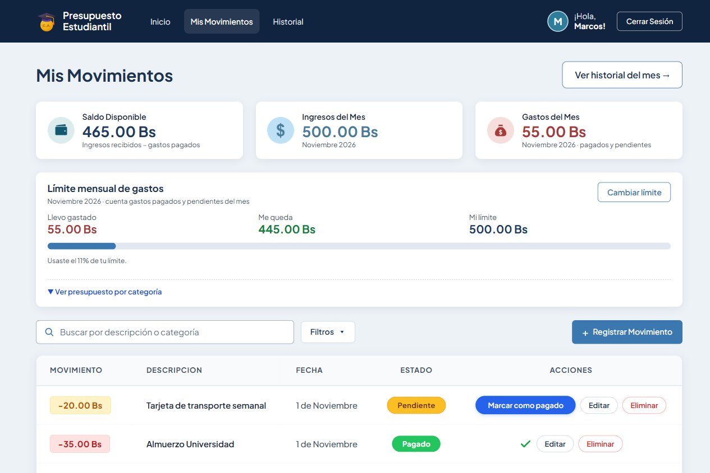
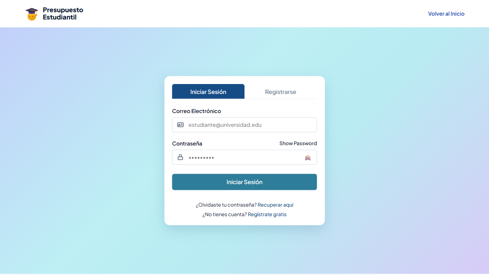
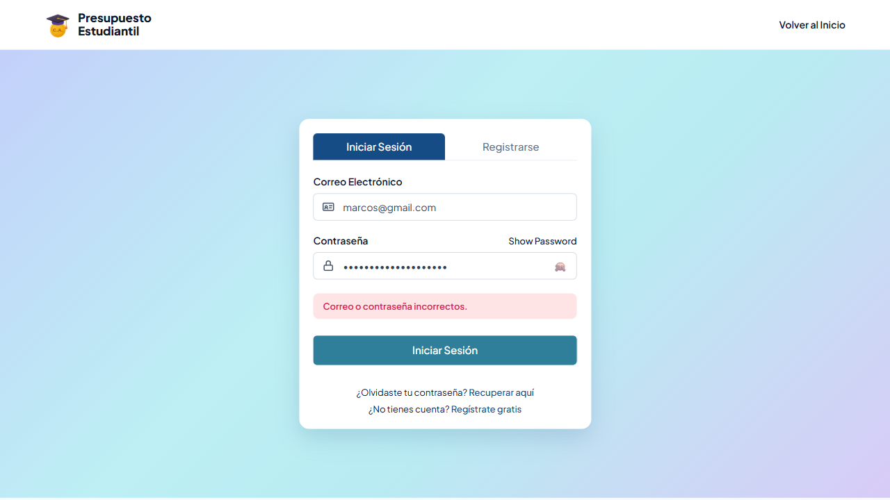
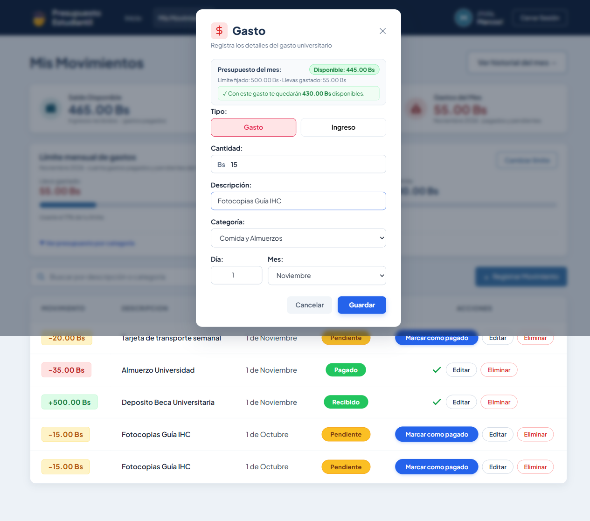
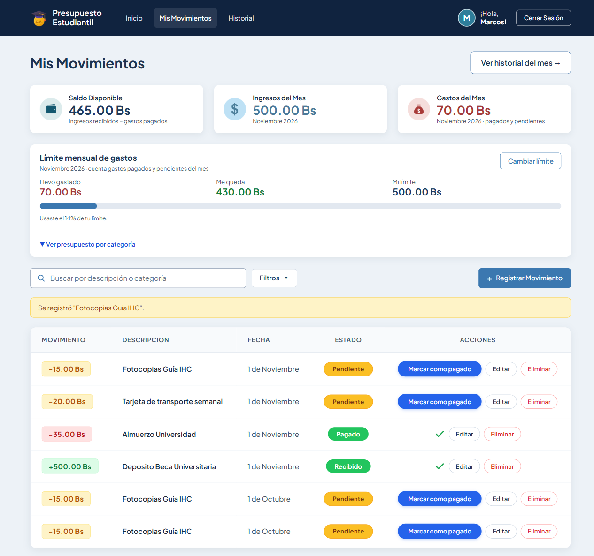
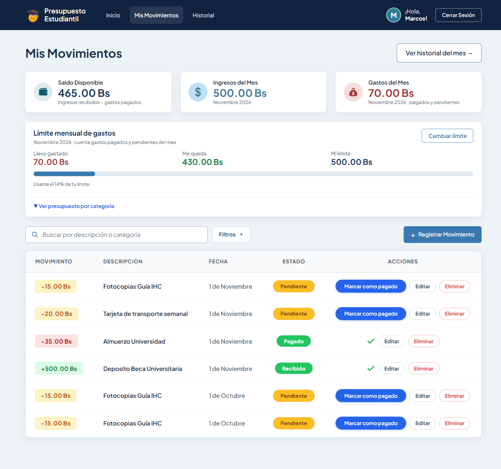
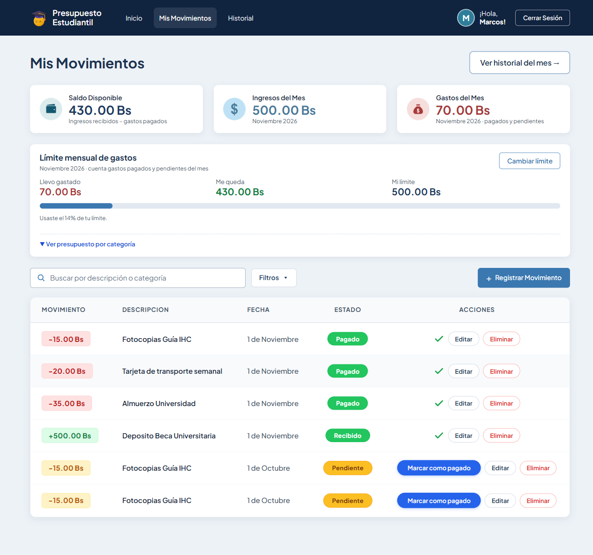

# Tarea 6 — Evidencias de Tests E2E

**Alumno:** Guzmán Montalván Marcos Lehonti  
**Proyecto:** Presupuesto Estudiantil  
**Entrega:** martes 03/11/2026 a las 18:00  
**Runner:** Playwright (`pnpm exec playwright test`)

---

## Matriz de cobertura

| Flujo | Tipo | Archivo de test | Resultado | Captura |
|-------|------|----------------|-----------|---------|
| Pantalla de login (vista inicial) | Visual | `tests/login.spec.js` | ✅ PASA | [login-00](tarea-6/login-00-pantalla-login.png) |
| Iniciar sesión con credenciales correctas | Principal | `tests/login.spec.js` | ✅ PASA | [login-01](tarea-6/login-01-sesion-exitosa.png) |
| Cerrar sesión (logout) | Principal | `tests/login.spec.js` | ✅ PASA | [login-02](tarea-6/login-02-logout.png) |
| Contraseña incorrecta → mensaje de error | Alternativo | `tests/login.spec.js` | ✅ PASA | [login-03](tarea-6/login-03-error-credenciales.png) |
| Registrar nuevo gasto y verificar incremento de total | Principal | `tests/registrar-gasto.spec.js` | ✅ PASA | [gasto-02](tarea-6/gasto-02-gasto-registrado.png) |
| Cancelar registro sin alterar el saldo | Alternativo | `tests/registrar-gasto.spec.js` | ✅ PASA | [gasto-03](tarea-6/gasto-03-cancelar-registro.png) |
| Marcar gasto como pagado (transición pendiente → pagado) | Principal | `tests/marcar-pagado.spec.js` | ✅ PASA | [pagado-02](tarea-6/pagado-02-despues-pagado.png) |
| Bloqueo de doble pago en UI (icono check sin botón) | Alternativo | `tests/marcar-pagado.spec.js` | ✅ PASA | [pagado-03](tarea-6/pagado-03-bloqueo-doble-pago.png) |
| Editar / Eliminar movimiento | Principal | `tests/editar-eliminar.spec.js` | 🔲 pendiente | — |
| Buscar y filtrar movimientos | Principal | `tests/filtros.spec.js` | 🔲 pendiente | — |
| Definir límite mensual | Principal | `tests/limite-mensual.spec.js` | 🔲 pendiente | — |
| Presupuesto por categoría | Principal | `tests/presupuesto-categoria.spec.js` | 🔲 pendiente | — |
| Ver historial | Principal | `tests/historial.spec.js` | 🔲 pendiente | — |
| Accesibilidad (axe-core) | Accesibilidad | `tests/accesibilidad.spec.js` | 🔲 pendiente | — |
| Gastos recurrentes (nueva feature) | Principal | `tests/recurrentes.spec.js` | 🔲 pendiente | — |

---

## Prueba 1 — Login y Logout

**Archivo:** `tests/login.spec.js`  
**Comando de ejecución:** `pnpm exec playwright test login --headed`

### Qué se verifica

| # | Verificación | ¿Pasa? |
|---|-------------|--------|
| 1 | Pantalla de login carga correctamente | ✅ |
| 2 | Con email `marcos@gmail.com` y contraseña `123456` se redirige a `/movimientos` | ✅ |
| 3 | La pantalla principal muestra el saludo con "Marcos" | ✅ |
| 4 | El botón de logout es visible y al hacer clic regresa a `/login` | ✅ |
| 5 | Con contraseña incorrecta aparece un mensaje de error en pantalla | ✅ |
| 6 | Con contraseña incorrecta la URL permanece en `/login` (no redirige) | ✅ |

### Capturas generadas

**Pantalla inicial de Login:**  

**Sesión iniciada correctamente (dashboard visible con saludo a Marcos):**  

**Después del logout (regreso al login):**  

**Flujo alternativo — Error por contraseña incorrecta:**  

---

## Prueba 2 — Registrar Gasto

**Archivo:** `tests/registrar-gasto.spec.js`  
**Comando de ejecución:** `pnpm exec playwright test registrar-gasto --headed`

### Qué se verifica

| # | Verificación | ¿Pasa? |
|---|-------------|--------|
| 1 | Al pulsar `+ Registrar Movimiento` se abre el modal de registro | ✅ |
| 2 | Se ingresan monto (15.00 Bs), descripción y se selecciona mes Noviembre | ✅ |
| 3 | Al guardar (POST `/movimientos`), la tarjeta de "Gastos del Mes" se incrementa exactamente en 15.00 Bs | ✅ |
| 4 | **Flujo alternativo:** Al pulsar "Cancelar", el modal se cierra y el saldo de gastos permanece intacto sin registrar nada | ✅ |

### Capturas generadas

**Modal de registro con datos ingresados:**  

**Gasto registrado exitosamente (total del mes actualizado):**  

**Flujo alternativo — Cancelación de registro (saldo intacto):**  

---

## Prueba 3 — Marcar Gasto como Pagado

**Archivo:** `tests/marcar-pagado.spec.js`  
**Comando de ejecución:** `pnpm exec playwright test marcar-pagado --headed`

### Qué se verifica

| # | Verificación | ¿Pasa? |
|---|-------------|--------|
| 1 | La tabla muestra movimientos con estado `Pendiente` y el botón `Marcar como pagado` | 🔲 |
| 2 | Al pulsar `Marcar como pagado` se envía `PATCH /movimientos/:id/pagado` | 🔲 |
| 3 | El badge de estado cambia de `Pendiente` a `Pagado` | 🔲 |
| 4 | El botón desaparece y se muestra el icono de check verde (`.estado-pagado-check`) | 🔲 |
| 5 | **Flujo alternativo:** Los movimientos con estado `Pagado` no muestran botón de pago, bloqueando dobles pagos accidentales desde la UI | 🔲 |

### Capturas generadas

**Movimiento antes de pagar (estado Pendiente con botón visible):**  

**Movimiento marcado como Pagado (transición exitosa con check verde):**  

**Flujo alternativo — Protección contra doble pago en la interfaz:**  

---

> **Nota:** Las imágenes son generadas automáticamente por Playwright en la carpeta `docs/evidencias/tarea-6/`.

---

*Este archivo se irá completando conforme se ejecuten los demás tests.*
