# Tarea 6 — Evidencias de Tests E2E

**Alumno:** Guzmán Montalván Marcos Lehonti  
**Proyecto:** Presupuesto Estudiantil  
**Entrega:** martes 03/11/2026 a las 18:00  
**Runner:** Playwright (`pnpm exec playwright test`)

---

## Matriz de cobertura

| Flujo | Tipo | Archivo de test | Resultado | Captura |
|-------|------|----------------|-----------|---------|
| Pantalla de login (vista inicial) | Visual | `tests/login.spec.js` | ✅ PASA | [login-00](tarea-6/login-00-pantalla-login.png) |
| Iniciar sesión con credenciales correctas | Principal | `tests/login.spec.js` | ✅ PASA | [login-01](tarea-6/login-01-sesion-exitosa.png) |
| Cerrar sesión (logout) | Principal | `tests/login.spec.js` | ✅ PASA | [login-02](tarea-6/login-02-logout.png) |
| Contraseña incorrecta → mensaje de error | Alternativo | `tests/login.spec.js` | ✅ PASA | [login-03](tarea-6/login-03-error-credenciales.png) |
| Registrar nuevo gasto y verificar incremento de total | Principal | `tests/registrar-gasto.spec.js` | ✅ PASA | [gasto-02](tarea-6/gasto-02-gasto-registrado.png) |
| Cancelar registro sin alterar el saldo | Alternativo | `tests/registrar-gasto.spec.js` | ✅ PASA | [gasto-03](tarea-6/gasto-03-cancelar-registro.png) |
| Marcar gasto como pagado (transición pendiente → pagado) | Principal | `tests/marcar-pagado.spec.js` | ✅ PASA | [pagado-02](tarea-6/pagado-02-despues-pagado.png) |
| Bloqueo de doble pago en UI (icono check sin botón) | Alternativo | `tests/marcar-pagado.spec.js` | ✅ PASA | [pagado-03](tarea-6/pagado-03-bloqueo-doble-pago.png) |
| Editar descripción de un movimiento | Principal | `tests/editar-eliminar.spec.js` | ✅ PASA | [editar-02](tarea-6/editar-02-descripcion-actualizada.png) |
| Bloqueo de edición de monto en gasto pagado | Alternativo | `tests/editar-eliminar.spec.js` | ✅ PASA | [editar-03](tarea-6/editar-03-monto-bloqueado.png) |
| Eliminar movimiento con diálogo de confirmación | Principal | `tests/editar-eliminar.spec.js` | ✅ PASA | [eliminar-02](tarea-6/eliminar-02-movimiento-eliminado.png) |
| Buscar movimientos por descripción | Principal | `tests/filtros.spec.js` | ✅ PASA | [filtros-01](tarea-6/filtros-01-busqueda-texto.png) |
| Filtrar por tipo (solo Gastos) | Principal | `tests/filtros.spec.js` | ✅ PASA | [filtros-02](tarea-6/filtros-02-filtro-gastos.png) |
| Búsqueda sin resultados → lista vacía | Alternativo | `tests/filtros.spec.js` | ✅ PASA | [filtros-03](tarea-6/filtros-03-lista-vacia.png) |
| Definir límite mensual y verificar actualización | Principal | `tests/limite-mensual.spec.js` | ✅ PASA | [limite-04](tarea-6/limite-04-actualizado.png) |
| Límite inválido (menor al gasto actual) → error | Alternativo | `tests/limite-mensual.spec.js` | ✅ PASA | [limite-05](tarea-6/limite-05-error-limite.png) |
| Expandir panel de categorías y verificar presupuesto de Comida | Principal | `tests/presupuesto-categoria.spec.js` | ✅ PASA | [cat-02](tarea-6/cat-02-panel-expandido.png) |
| Asignar presupuesto a Transporte via prompt() y verificar | Alternativo | `tests/presupuesto-categoria.spec.js` | ✅ PASA | [cat-04](tarea-6/cat-04-limite-asignado.png) |
| Navegar al historial y verificar movimientos del mes | Principal | `tests/historial.spec.js` | ✅ PASA | [historial-02](tarea-6/historial-02-movimientos.png) |
| Navegar al mes anterior con botón de navegación | Alternativo | `tests/historial.spec.js` | ✅ PASA | [historial-03](tarea-6/historial-03-mes-anterior.png) |
| Accesibilidad /login — sin violaciones críticas WCAG 2.0 AA | Accesibilidad | `tests/accesibilidad.spec.js` | ✅ PASA | [acc-01](tarea-6/accesibilidad-01-login.png) |
| Accesibilidad /movimientos — sin violaciones críticas WCAG 2.0 AA | Accesibilidad | `tests/accesibilidad.spec.js` | ✅ PASA | [acc-02](tarea-6/accesibilidad-02-movimientos.png) |
| Accesibilidad /historial — sin violaciones críticas WCAG 2.0 AA | Accesibilidad | `tests/accesibilidad.spec.js` | ✅ PASA | [acc-03](tarea-6/accesibilidad-03-historial.png) |
| Gastos recurrentes (nueva feature) | Principal | `tests/recurrentes.spec.js` | 🔲 pendiente | — |

---

## Evidencia de Suite Completa — Estado Base ("ANTES")

> **Ejecución previa a la implementación de la nueva funcionalidad (Gastos Recurrentes):**
> - **Secuencia ejecutada:** `pnpm run seed` seguido de `pnpm exec playwright test`
> - **Resultado global:** **23 passed (100% verde)** en 1.0m.
> - **Módulos auditados:** Login/Logout, Registro de gastos, Marcar pagado, Edición/Eliminación con reglas de saldo, Búsqueda y Filtros, Límite mensual, Presupuesto por categoría, Historial y Accesibilidad WCAG 2.0 AA (axe-core).

**Captura de terminal con la suite completa en verde:**  
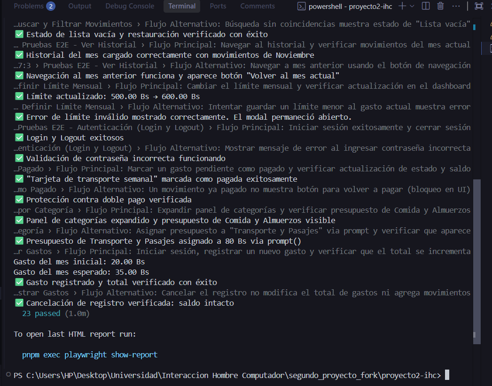

---

## Prueba 1 — Login y Logout

**Archivo:** `tests/login.spec.js`  
**Comando de ejecución:** `pnpm exec playwright test login --headed`

### Qué se verifica

| # | Verificación | ¿Pasa? |
|---|-------------|--------|
| 1 | Pantalla de login carga correctamente | ✅ |
| 2 | Con email `marcos@gmail.com` y contraseña `123456` se redirige a `/movimientos` | ✅ |
| 3 | La pantalla principal muestra el saludo con "Marcos" | ✅ |
| 4 | El botón de logout es visible y al hacer clic regresa a `/login` | ✅ |
| 5 | Con contraseña incorrecta aparece un mensaje de error en pantalla | ✅ |
| 6 | Con contraseña incorrecta la URL permanece en `/login` (no redirige) | ✅ |

### Capturas generadas

**Pantalla inicial de Login:**  

**Sesión iniciada correctamente (dashboard visible con saludo a Marcos):**  

**Después del logout (regreso al login):**  

**Flujo alternativo — Error por contraseña incorrecta:**  

---

## Prueba 2 — Registrar Gasto

**Archivo:** `tests/registrar-gasto.spec.js`  
**Comando de ejecución:** `pnpm exec playwright test registrar-gasto --headed`

### Qué se verifica

| # | Verificación | ¿Pasa? |
|---|-------------|--------|
| 1 | Al pulsar `+ Registrar Movimiento` se abre el modal de registro | ✅ |
| 2 | Se ingresan monto (15.00 Bs), descripción y se selecciona mes Noviembre | ✅ |
| 3 | Al guardar (POST `/movimientos`), la tarjeta de "Gastos del Mes" se incrementa exactamente en 15.00 Bs | ✅ |
| 4 | **Flujo alternativo:** Al pulsar "Cancelar", el modal se cierra y el saldo de gastos permanece intacto sin registrar nada | ✅ |

### Capturas generadas

**Modal de registro con datos ingresados:**  

**Gasto registrado exitosamente (total del mes actualizado):**  

**Flujo alternativo — Cancelación de registro (saldo intacto):**  

---

## Prueba 3 — Marcar Gasto como Pagado

**Archivo:** `tests/marcar-pagado.spec.js`  
**Comando de ejecución:** `pnpm exec playwright test marcar-pagado --headed`

### Qué se verifica

| # | Verificación | ¿Pasa? |
|---|-------------|--------|
| 1 | La tabla muestra movimientos con estado `Pendiente` y el botón `Marcar como pagado` | ✅ |
| 2 | Al pulsar `Marcar como pagado` se envía `PATCH /movimientos/:id/pagado` | ✅ |
| 3 | El badge de estado cambia de `Pendiente` a `Pagado` | ✅ |
| 4 | El botón desaparece y se muestra el icono de check verde (`.estado-pagado-check`) | ✅ |
| 5 | **Flujo alternativo:** Los movimientos con estado `Pagado` no muestran botón de pago, bloqueando dobles pagos accidentales desde la UI | ✅ |

### Capturas generadas

**Movimiento antes de pagar (estado Pendiente con botón visible):**  

**Movimiento marcado como Pagado (transición exitosa con check verde):**  

**Flujo alternativo — Protección contra doble pago en la interfaz:**  

---

## Prueba 4 — Editar y Eliminar Movimientos

**Archivo:** `tests/editar-eliminar.spec.js`  
**Comando de ejecución:** `pnpm exec playwright test editar-eliminar --headed`

### Qué se verifica

| # | Verificación | ¿Pasa? |
|---|-------------|--------|
| 1 | Al pulsar el botón `Editar`, se abre el modal con los datos cargados | ✅ |
| 2 | Se modifica la descripción a *"Almuerzo Universidad Buffet"* y al guardar (PUT `/movimientos/:id`) la tabla refleja el cambio | ✅ |
| 3 | **Flujo alternativo:** En un gasto ya pagado, el campo de cantidad está deshabilitado (`disabled`) y se muestra el mensaje de regla de negocio bloqueando la edición del monto | ✅ |
| 4 | Al pulsar `Eliminar`, se abre el cuadro de diálogo de confirmación (`role="alertdialog"`) | ✅ |
| 5 | Al confirmar (DELETE `/movimientos/:id`), el registro desaparece de la tabla | ✅ |

### Capturas generadas

**Modal de edición de movimiento:**  

**Descripción actualizada en la tabla:**  
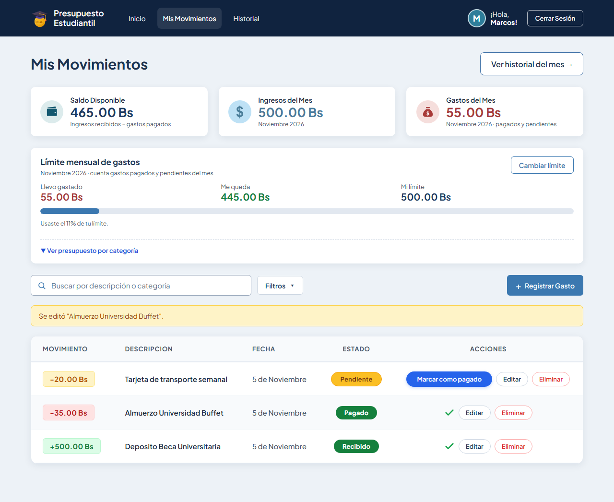

**Flujo alternativo — Monto bloqueado en gasto pagado:**  
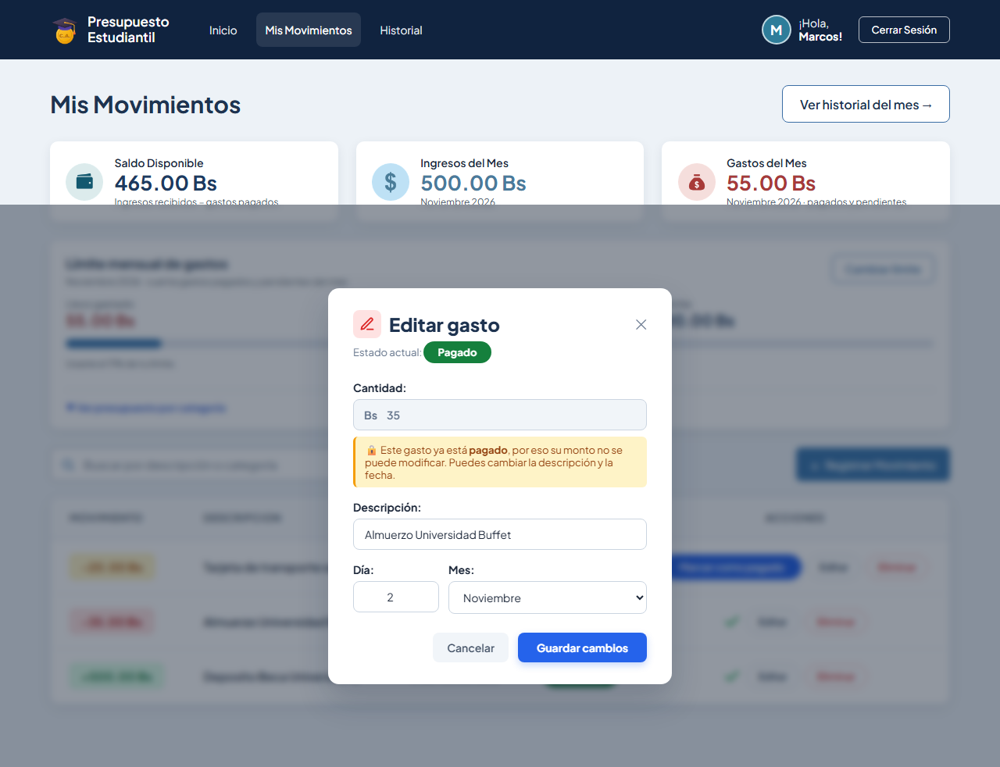

**Modal de confirmación para eliminar:**  
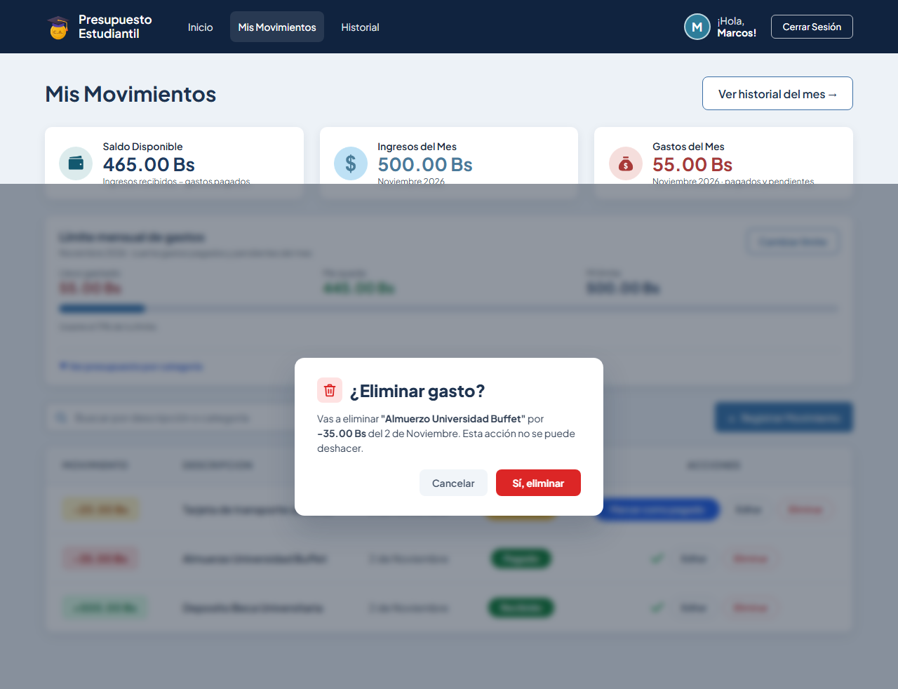

**Tabla actualizada tras eliminar el movimiento:**  
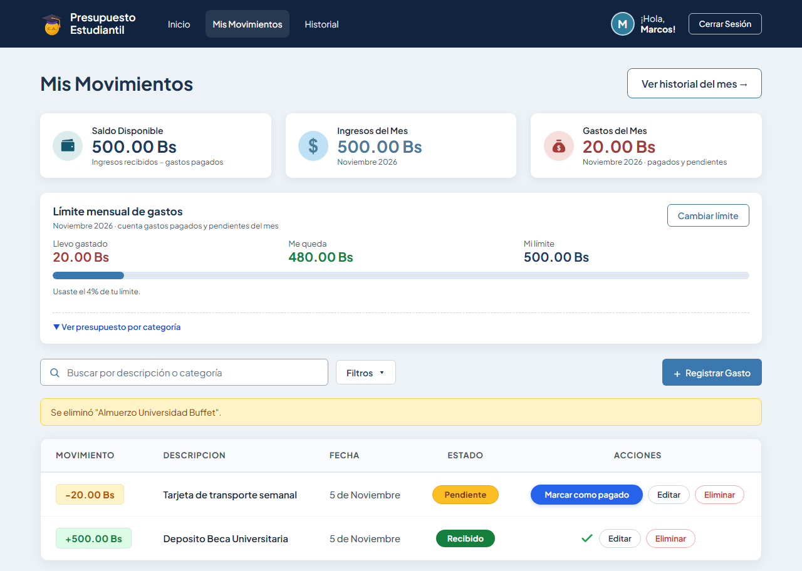

---

## Prueba 5 — Buscar y Filtrar Movimientos

**Archivo:** `tests/filtros.spec.js`  
**Comando de ejecución:** `pnpm exec playwright test filtros --headed`

### Qué se verifica

| # | Verificación | ¿Pasa? |
|---|-------------|--------|
| 1 | Al escribir "Beca" en el buscador, solo aparece la fila del Depósito Beca Universitaria (1 resultado) | ✅ |
| 2 | Al limpiar el buscador, vuelven a aparecer todos los movimientos | ✅ |
| 3 | Al abrir el panel de Filtros y seleccionar tipo "Gastos", la fila del ingreso (+500 Bs) desaparece y se muestra un chip de filtro activo | ✅ |
| 4 | **Flujo alternativo:** Al buscar un texto inexistente, se muestra el estado de lista vacía con el mensaje "Ningún movimiento coincide con tu búsqueda" | ✅ |
| 5 | Al pulsar "Quitar todos los filtros", se restaura la tabla completa | ✅ |

### Capturas generadas

**Búsqueda activa por texto "Beca" (1 resultado):**  
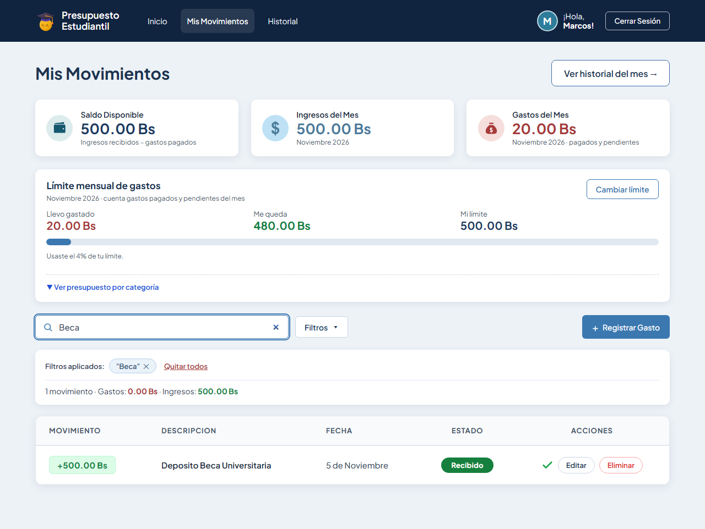

**Panel de filtros con filtro de tipo "Gastos" aplicado:**  

**Flujo alternativo — Lista vacía ante búsqueda sin resultados:**  
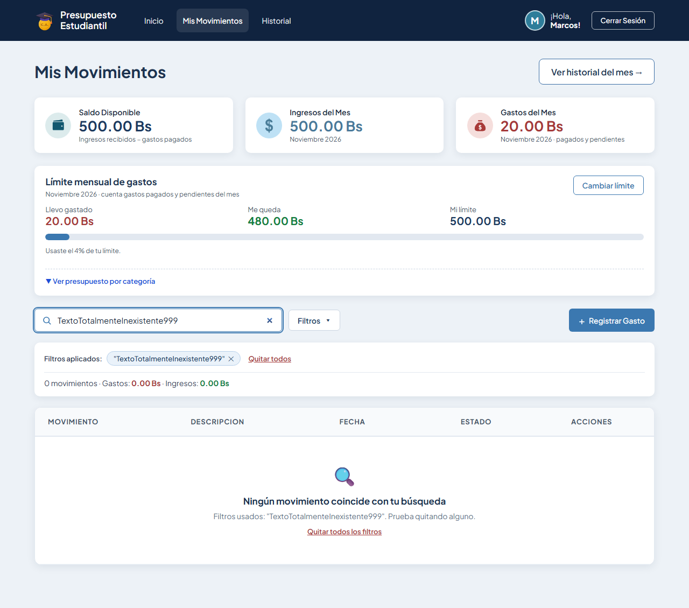

---

---

## Prueba 6 — Definir Límite Mensual

**Archivo:** `tests/limite-mensual.spec.js`  
**Comando de ejecución:** `pnpm exec playwright test limite-mensual --headed`

### Qué se verifica

| # | Verificación | ¿Pasa? |
|---|-------------|--------|
| 1 | El dashboard muestra el límite actual antes de abrir el modal | ✅ |
| 2 | Al hacer clic en "Cambiar límite" se abre el modal con el campo `#input-limite` | ✅ |
| 3 | Al escribir 600 Bs aparece la proyección positiva (`.proyeccion-disponible-ok`) | ✅ |
| 4 | Al guardar, el frontend llama `PUT /limite` y el servidor responde 200 | ✅ |
| 5 | El modal se cierra automáticamente tras guardar | ✅ |
| 6 | El span "Mi límite" en el dashboard se actualiza a 600.00 Bs | ✅ |
| 7 | **Flujo alternativo:** Escribir 1 Bs (menor al gasto del mes) muestra el error `#error-limite` | ✅ |
| 8 | El modal permanece abierto cuando el límite es inválido | ✅ |

### Capturas generadas

**Dashboard antes de cambiar el límite:**  
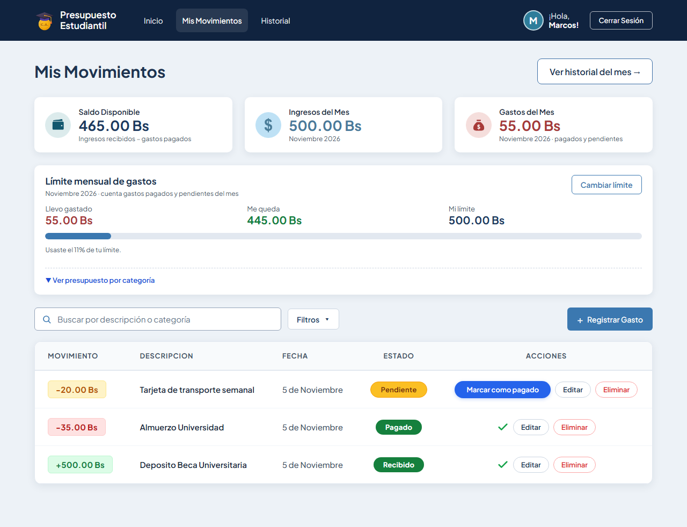

**Modal de límite mensual abierto:**  

**Proyección positiva al escribir 600 Bs:**  
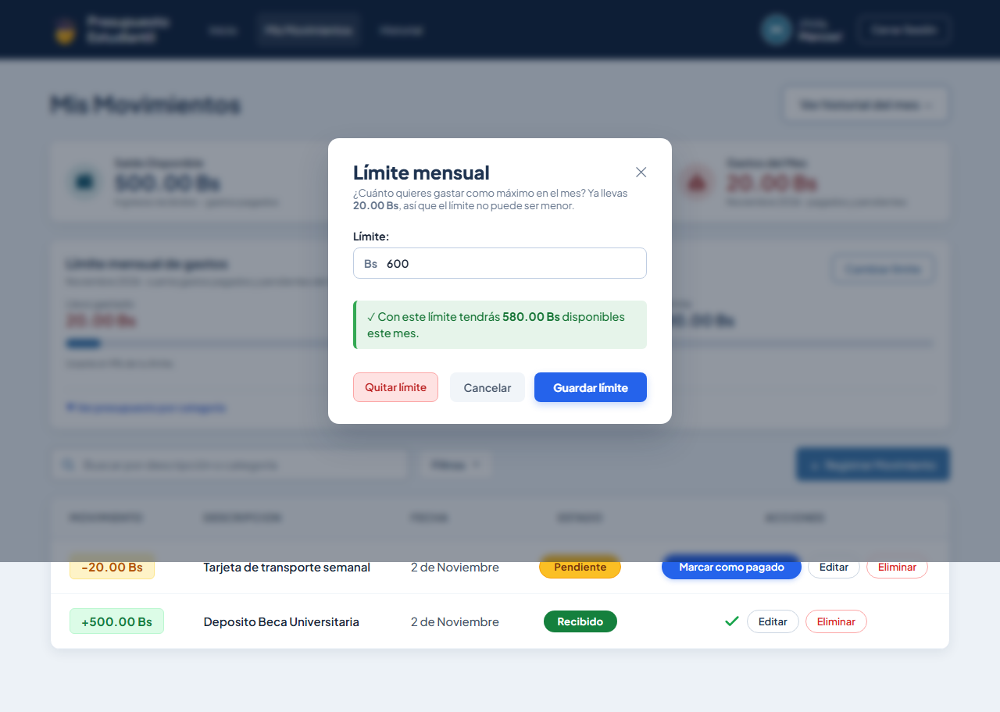

**Dashboard actualizado con nuevo límite de 600 Bs:**  
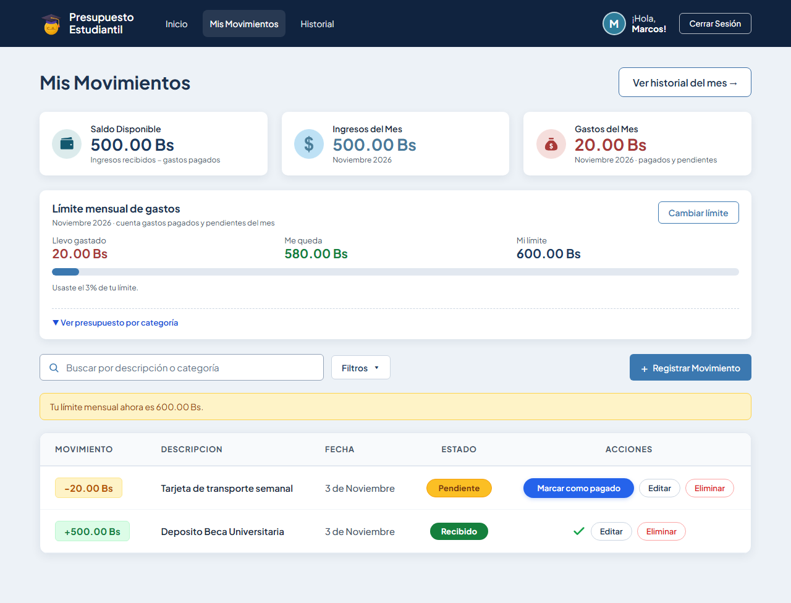

**Flujo alternativo — Error por límite menor al gasto actual:**  
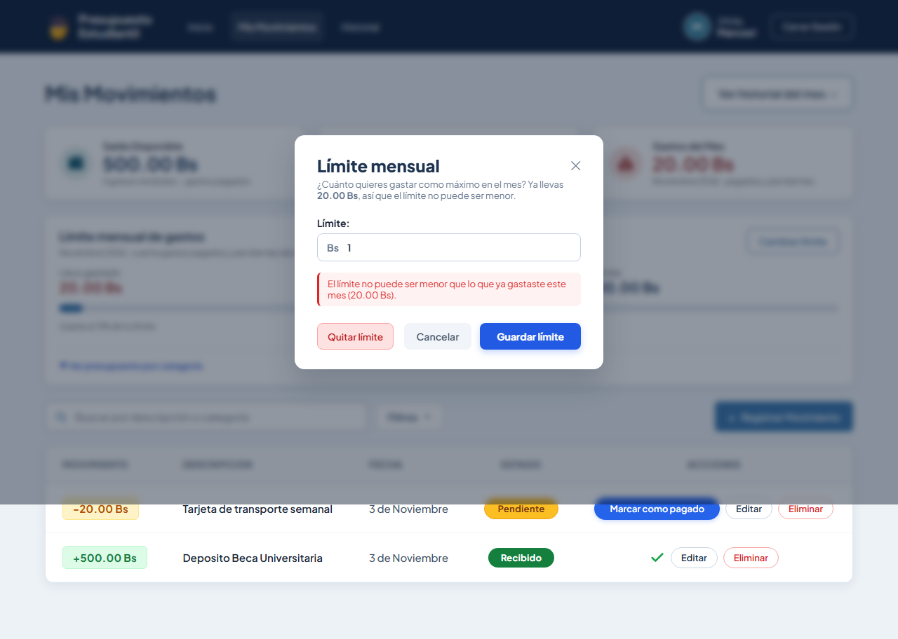

---

## Prueba 7 — Presupuesto por Categoría

**Archivo:** `tests/presupuesto-categoria.spec.js`  
**Comando de ejecución:** `pnpm exec playwright test presupuesto-categoria --headed`

### Qué se verifica

| # | Verificación | ¿Pasa? |
|---|-------------|--------|
| 1 | El botón "▼ Ver presupuesto por categoría" está visible y el panel está colapsado por defecto | ✅ |
| 2 | Al hacer clic, el panel se expande y llama a `GET /presupuestos-categoria` | ✅ |
| 3 | La categoría "Comida y Almuerzos" aparece con su límite de 150 Bs (cargado por semilla) | ✅ |
| 4 | **Flujo alternativo:** Al hacer clic en "Asignar" de "Transporte y Pasajes" aparece un `prompt()` nativo | ✅ |
| 5 | Al aceptar el prompt con 80 Bs, el frontend llama `POST /presupuestos-categoria` | ✅ |
| 6 | La lista se recarga y "Transporte y Pasajes" muestra el límite de 80 Bs | ✅ |

### Capturas generadas

**Panel de categorías colapsado (estado inicial):**  
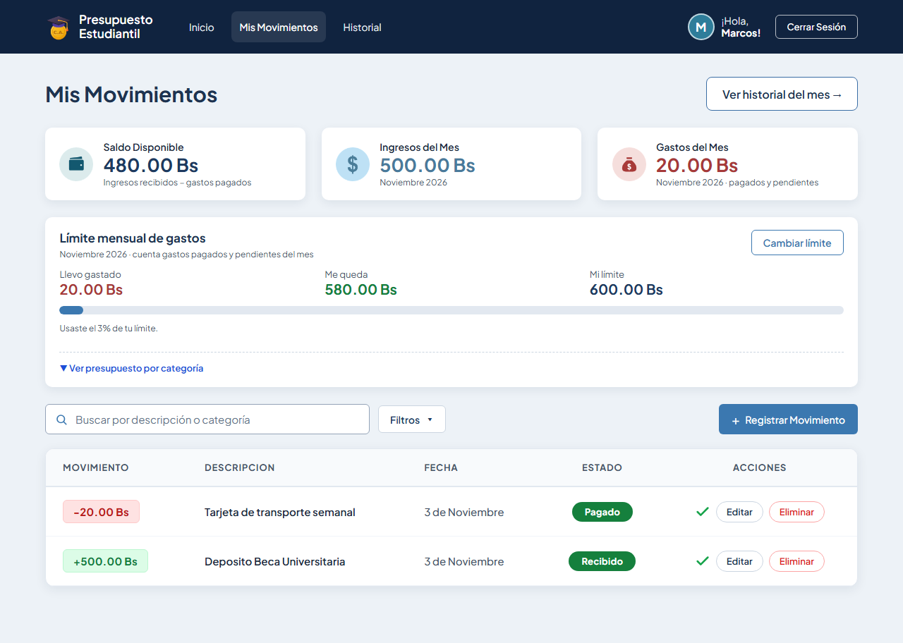

**Panel expandido con presupuesto de "Comida y Almuerzos" (150 Bs):**  
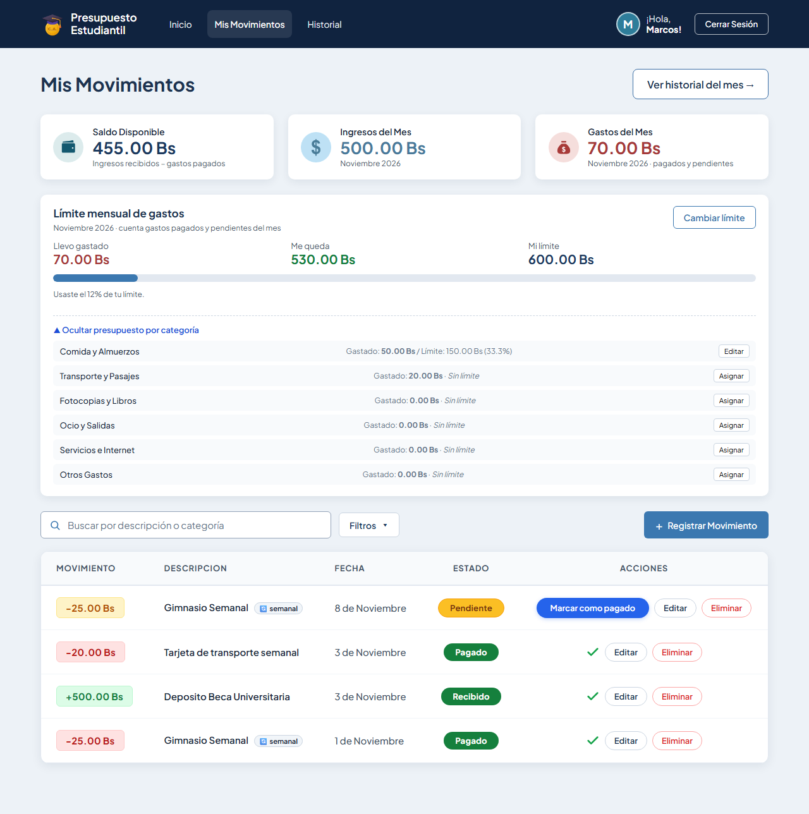

**Botón "Asignar" visible para Transporte antes de asignar:**  

**Límite de 80 Bs asignado a "Transporte y Pasajes":**  
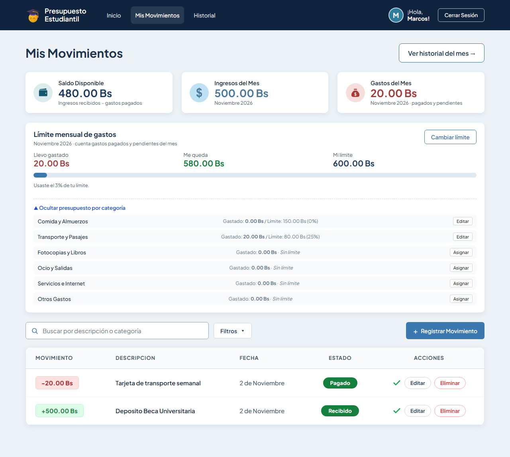

---

## Prueba 8 — Ver Historial

**Archivo:** `tests/historial.spec.js`  
**Comando de ejecución:** `pnpm exec playwright test historial --headed`

### Qué se verifica

| # | Verificación | ¿Pasa? |
|---|-------------|--------|
| 1 | El link "Historial" del navbar navega a `/historial` | ✅ |
| 2 | La página muestra el título "Historial del mes" | ✅ |
| 3 | El mes actual "Noviembre" aparece en el encabezado | ✅ |
| 4 | El bloque `.resumen-mes` con ingresos, gastos y balance es visible | ✅ |
| 5 | Aparecen movimientos agrupados por día (`.dia`) | ✅ |
| 6 | El movimiento "Beca Universitaria" de la semilla aparece en la lista | ✅ |
| 7 | **Flujo alternativo:** El botón de flecha izquierda cambia al mes anterior | ✅ |
| 8 | Aparece el botón "Volver al mes actual" al estar en un mes pasado | ✅ |

### Capturas generadas

**Página de historial cargada:**  
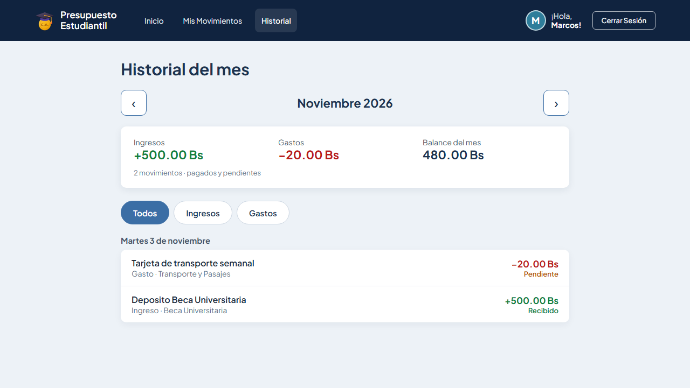

**Movimientos del mes de Noviembre:**  

**Navegación al mes anterior con botón de retorno:**  
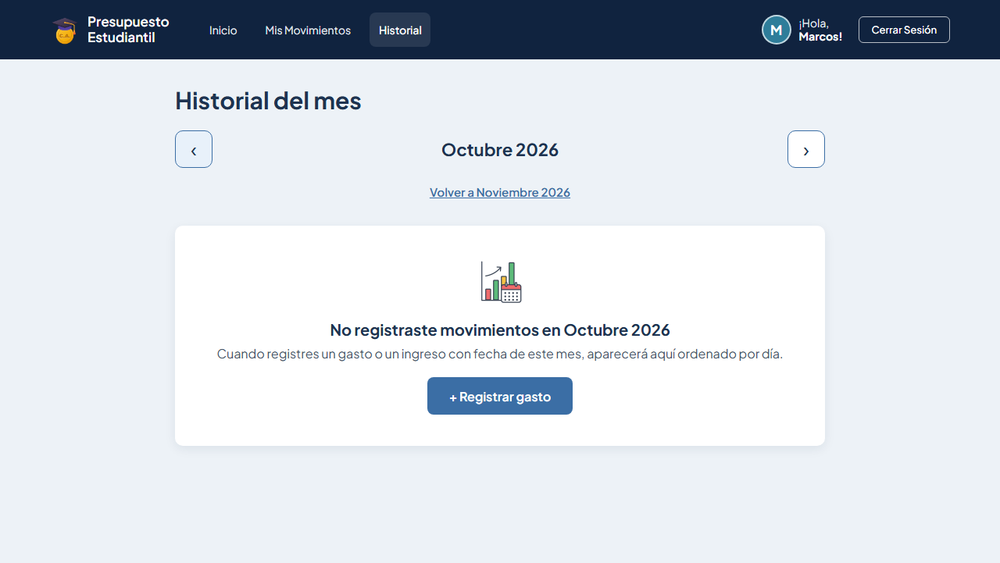

---

## Prueba 9 — Accesibilidad (axe-core)

**Archivo:** `tests/accesibilidad.spec.js`  
**Comando de ejecución:** `pnpm exec playwright test accesibilidad --headed`  
**Herramienta:** `@axe-core/playwright` — estándar WCAG 2.0 AA

### Qué se verifica

| # | Página | Violaciones críticas/serias | ¿Pasa? |
|---|--------|----------------------------|--------|
| 1 | `/login` | 0 | ✅ |
| 2 | `/movimientos` | 0 | ✅ |
| 3 | `/historial` | 0 | ✅ |

> El análisis filtra solo violaciones de impacto `critical` y `serious`. Las violaciones menores (`moderate`, `minor`) se registran en consola pero no fallan el test.

### Capturas generadas

**Pantalla de login analizada:**  

**Pantalla principal de movimientos analizada:**  

**Pantalla de historial analizada:**  
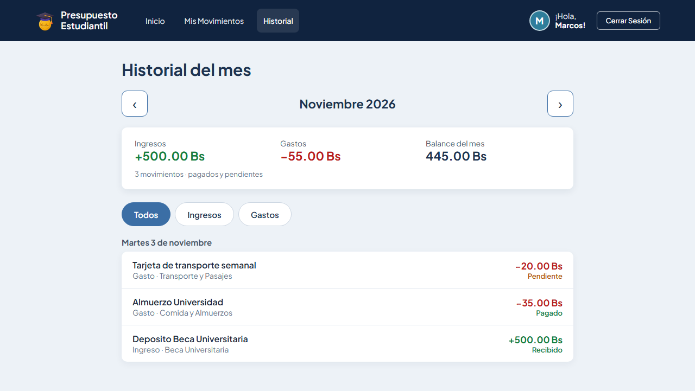

---

> *Este archivo se irá completando conforme se ejecuten los demás tests.*

---

*Este archivo se irá completando conforme se ejecuten los demás tests.*
