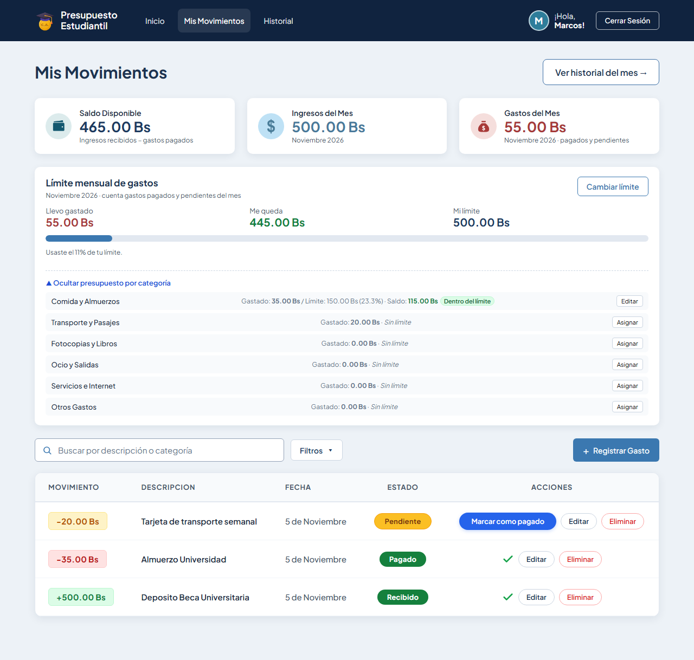
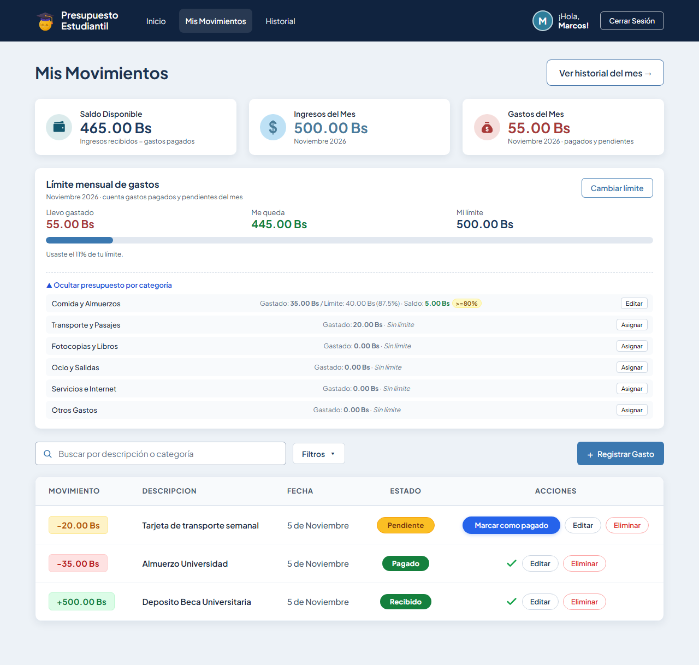
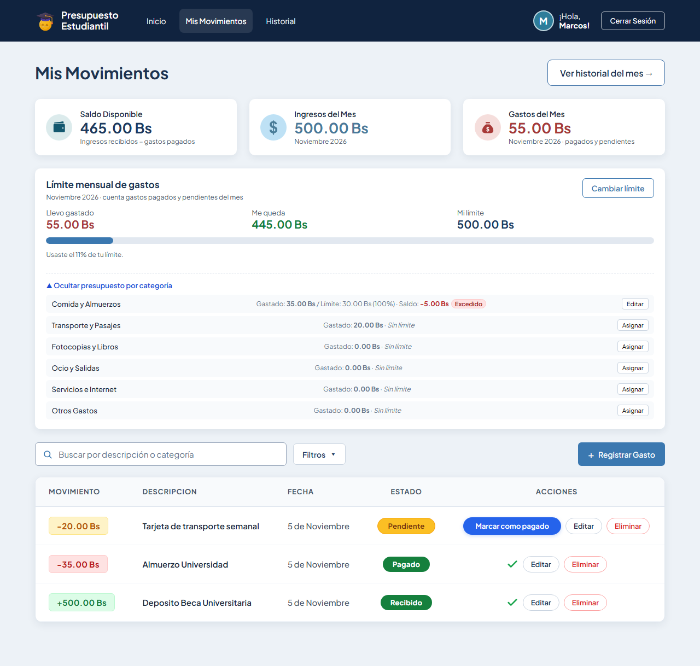
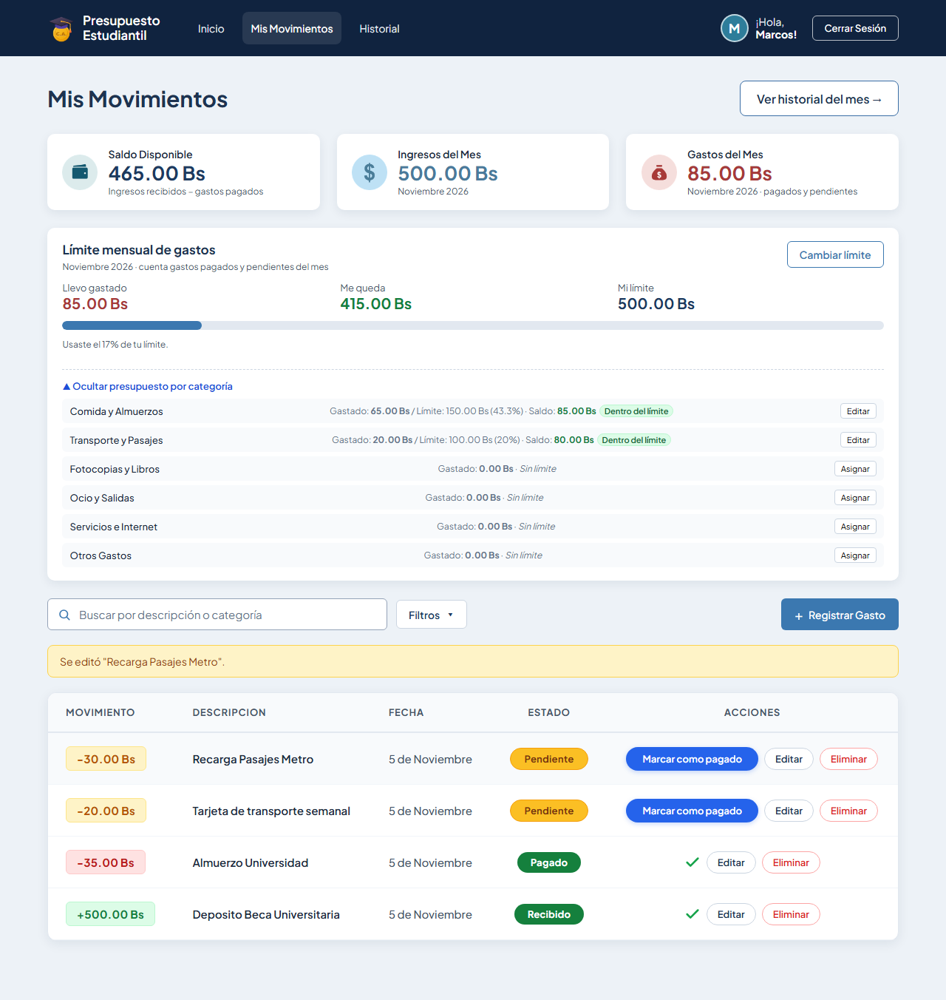
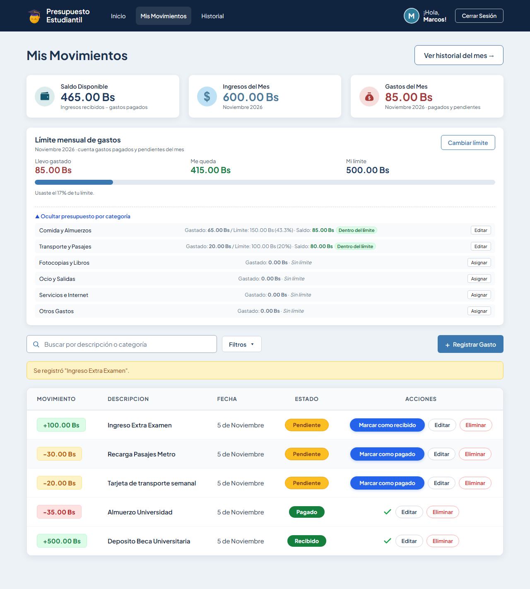
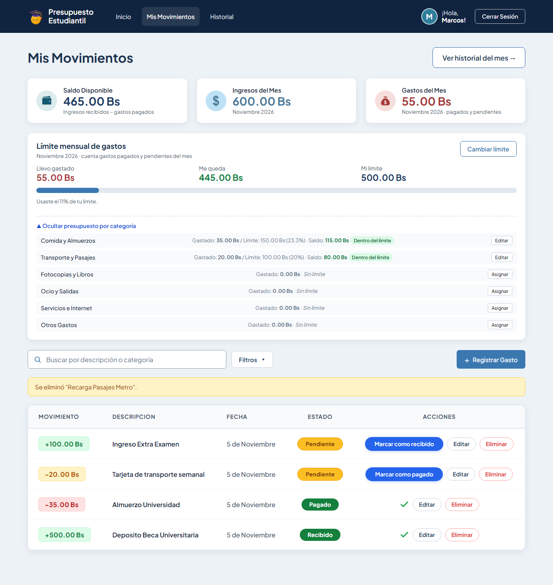

# Tarea 7 — Mejoras de UX y Gestión de Límites por Categoría y Mes

**Proyecto:** Presupuesto Estudiantil  
**Evaluador / Alumno:** Guzmán Montalvan Marcos Lehonti  
**Fecha:** 05 de Noviembre de 2026  
**Repositorio Propio:** [PROYECTO2-IHC en GitHub](https://github.com/MarcosLehonti/PROYECTO2-IHC.git)  
**Repositorio Evaluado (Feedback Recibido):** [proyecto2_ihc de Lorgio Choque](https://github.com/Lorgio09/proyecto2_ihc.git)

---

## 1. Contexto: Feedback Recibido en Clase 19 y Correcciones Iniciales

Durante la evaluación entre pares de la Clase 19, el compañero **Lorgio Choque Severiche** evaluó el proyecto y registró su análisis en el repositorio con las siguientes observaciones principales:

1. **Ambigüedad en el botón principal:** La etiqueta `"+ Registrar Movimiento"` resultaba genérica para el modelo mental de un estudiante. Se corrigió renombrándolo a `"+ Registrar Gasto"`.
2. **Fecha estática en el formulario:** El formulario cargaba con valores fijos (`1 / Octubre`), obligando al usuario a seleccionar manualmente la fecha. Se corrigió precargando dinámicamente la fecha actual (`hoy.getDate()` y mes corriente) permitiendo seleccionar fechas pasadas o futuras.

---

## 2. Nueva Funcionalidad: Límites por Categoría y Mes con Recálculo Dinámico

Se implementó el sistema completo de **Presupuestos y Límites por Categoría y Mes** cumpliendo con todas las reglas de negocio y consistencia:

### Reglas de Negocio Implementadas
1. **Crear y editar límite mensual por categoría sin duplicados:**  
   Se utiliza una restricción única por `(usuario_id, categoria_id, mes)` tanto a nivel de base de datos (`uq_usuario_categoria_mes`) como en el endpoint `POST /presupuestos-categoria`. Si el límite ya existe para ese mes, se actualiza (`UPSERT`), evitando duplicados.
2. **Métricas visibles por categoría:**  
   Cada categoría con presupuesto muestra:
   - **Gasto acumulado** en el mes: `gastado` (suma de movimientos de tipo `gasto` en ese mes/categoría).
   - **Monto límite** asignado y porcentaje de uso: `monto_limite (porcentaje%)`.
   - **Saldo disponible**: `saldo` = `monto_limite - gastado`.
3. **Semáforo de estados:**
   - **Dentro del límite:** Cuando el consumo es menor al 80% (badge verde `Dentro del límite`).
   - **Alerta (>=80%):** Cuando el consumo alcanza o supera el 80% sin exceder el 100% (badge amarillo `>=80%`).
   - **Excedido:** Cuando el gasto supera el 100% del presupuesto (badge rojo `Excedido` y saldo en negativo).
4. **Recálculo automático al registrar, editar o eliminar gastos:**
   - **Registrar:** Al crear un gasto en una categoría, su presupuesto se actualiza de inmediato.
   - **Editar:** Si se modifica el monto, la fecha (mes) o se traslada el gasto a otra categoría, **ambos períodos y categorías afectados se recalculan automáticamente**.
   - **Eliminar:** Al borrar un gasto, el monto consumido se descuenta en tiempo real.
5. **Aislamiento de ingresos:**  
   Los movimientos de tipo `ingreso` **no consumen presupuesto** ni alteran los cálculos de límites de categoría.

---

## 3. Cambios Implementados en el Código

### Backend
- **[`PRESUPUESTO ESTUDIANTIL/BACKEND/schemas.py`](file:///C:/Users/HP/Desktop/Universidad/Interaccion%20Hombre%20Computador/segundo_proyecto_fork/PROYECTO2-IHC/PRESUPUESTO%20ESTUDIANTIL/BACKEND/schemas.py):**
  - Se extendió `MovimientoUpdate` para permitir actualizar la `categoria`.
  - Se extendió `PresupuestoCategoriaOut` con los campos calculados `saldo` y `estado` (`normal`, `alerta`, `excedido`, `sin_limite`).
- **[`PRESUPUESTO ESTUDIANTIL/BACKEND/routers/movimientos.py`](file:///C:/Users/HP/Desktop/Universidad/Interaccion%20Hombre%20Computador/segundo_proyecto_fork/PROYECTO2-IHC/PRESUPUESTO%20ESTUDIANTIL/BACKEND/routers/movimientos.py):**
  - Soporte en `editar_movimiento` para reasignar `categoria_id` al editar la categoría de un gasto.
- **[`PRESUPUESTO ESTUDIANTIL/BACKEND/routers/presupuestos.py`](file:///C:/Users/HP/Desktop/Universidad/Interaccion%20Hombre%20Computador/segundo_proyecto_fork/PROYECTO2-IHC/PRESUPUESTO%20ESTUDIANTIL/BACKEND/routers/presupuestos.py):**
  - En `listar_presupuestos_categoria` y `guardar_presupuesto_categoria` se calcula `saldo = monto_limite - gastado` y la clasificación semafórica de `estado`.

### Frontend
- **[`PRESUPUESTO ESTUDIANTIL/FRONTEND/src/views/MovimientosView.vue`](file:///C:/Users/HP/Desktop/Universidad/Interaccion%20Hombre%20Computador/segundo_proyecto_fork/PROYECTO2-IHC/PRESUPUESTO%20ESTUDIANTIL/FRONTEND/src/views/MovimientosView.vue):**
  - Modal de edición ahora cuenta con selector de categoría `#editar-categoria`.
  - Lista de presupuestos por categoría muestra gasto acumulado, límite, saldo y badges dinámicos (`.badge-cat-ok`, `.badge-cat-alerta`, `.badge-cat-excedido`).
  - Sincronización en tiempo real: `sincronizarDesdeServidor()` actualiza automáticamente las categorías si el panel se encuentra abierto tras crear, editar o eliminar movimientos.

---

## 4. Evidencias y Pruebas E2E Automatizadas (Playwright)

Se diseñó e implementó la suite completa de pruebas E2E en [`tests/limite-categoria-mes.spec.js`](file:///C:/Users/HP/Desktop/Universidad/Interaccion%20Hombre%20Computador/segundo_proyecto_fork/PROYECTO2-IHC/tests/limite-categoria-mes.spec.js), verificando cada regla de negocio con capturas de pantalla automáticas.

### Resumen de Ejecución
- **Total de pruebas en el proyecto:** 26 pruebas.
- **Resultado:** **26 pasadas, 0 fallidas (100% éxito)**.

```text
Running 26 tests using 1 worker
...
[14/26] [chromium] › tests\limite-categoria-mes.spec.js › Test 1: Visualizar gasto acumulado, saldo y estados
[15/26] [chromium] › tests\limite-categoria-mes.spec.js › Test 2: Registrar, editar categoría/fecha y eliminar gasto recalcula automáticamente ambos presupuestos afectados
...
26 passed (1.0m)
```

### Galería de Capturas Generadas

#### 1. Estado "Dentro del límite"
Muestra presupuesto de Comida y Almuerzos con consumo inicial bajo control (35 de 150 Bs gastados, saldo favorable y badge verde `Dentro del límite`).  


#### 2. Estado de Alerta (>=80%)
Al ajustar el límite mensual a 40 Bs con 35 Bs gastados (87.5% de consumo), se activa automáticamente el estado de advertencia con badge amarillo `>=80%`.  


#### 3. Estado "Excedido" con Saldo Negativo
Al fijar un límite menor al gasto acumulado (30 Bs vs 35 Bs gastados), el saldo pasa a rojo (`-5.00 Bs`) y se exhibe el badge rojo `Excedido`.  


#### 4. Recálculo tras Registrar Gasto
Al asignar 100 Bs a *Transporte y Pasajes* y registrar un gasto de 30 Bs, el gasto acumulado sube automáticamente de 20 Bs a 50 Bs.  


#### 5. Mover Gasto de Categoría Recalcula Ambas
Al editar el gasto de 30 Bs moviéndolo de *Transporte y Pasajes* a *Comida y Almuerzos*, se comprueba que **Transporte descuenta 30 Bs** y **Comida incrementa 30 Bs** simultáneamente.  


#### 6. Los Ingresos No Consumen Presupuesto
Al registrar un ingreso de 100 Bs, el presupuesto de las categorías se mantiene completamente intacto (gasto inalterado).  


#### 7. Eliminar Gasto Recalcula el Presupuesto
Al eliminar el gasto registrado, la categoría de destino descuenta el importe y vuelve exactamente a su saldo previo (35.00 Bs).  


---

## 5. Referencias

- **Feedback de origen:** Repositorio [`https://github.com/Lorgio09/proyecto2_ihc.git`](https://github.com/Lorgio09/proyecto2_ihc.git)
- **Documento de Feedback emitido:** [`docs/clase-19-feedback-a-otr-proyecto-/Guzman-Montalvan/feedback.md`](../clase-19-feedback-a-otr-proyecto-/Guzman-Montalvan/feedback.md)
- **Suite de Pruebas Tarea 7:** [`tests/limite-categoria-mes.spec.js`](file:///C:/Users/HP/Desktop/Universidad/Interaccion%20Hombre%20Computador/segundo_proyecto_fork/PROYECTO2-IHC/tests/limite-categoria-mes.spec.js)
