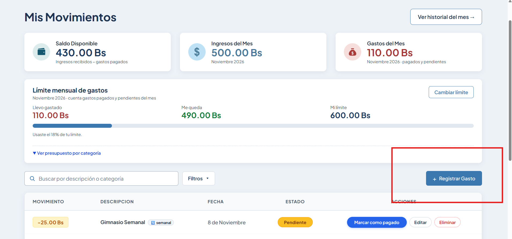
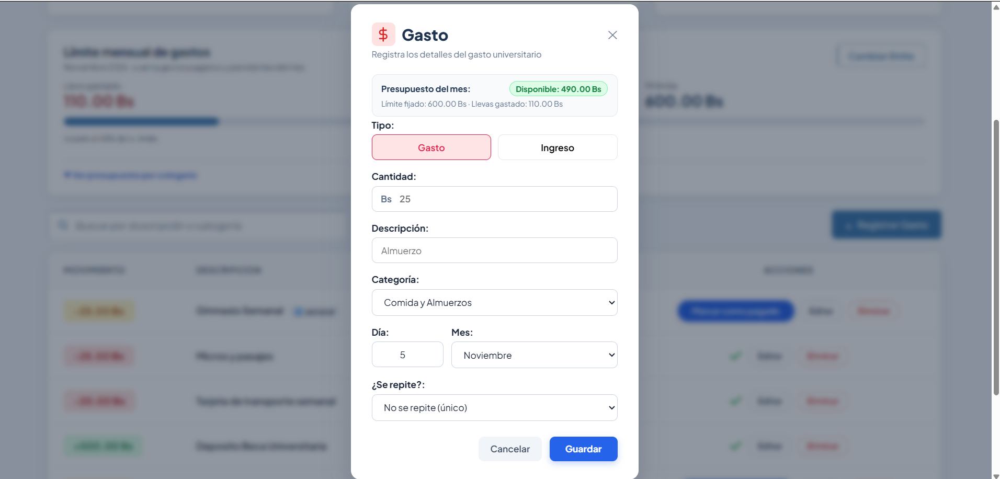

# Tarea 7 — Correcciones de Feedback y Nueva Funcionalidad de Límites por Categoría

**Proyecto:** Presupuesto Estudiantil  
**Evaluador / Alumno:** Guzmán Montalvan Marcos Lehonti  
**Fecha:** 05 de Noviembre de 2026  
**Repositorio Propio:** [PROYECTO2-IHC en GitHub](https://github.com/MarcosLehonti/PROYECTO2-IHC.git)  
**Repositorio Evaluado (Feedback Recibido):** [proyecto2_ihc de Lorgio Choque](https://github.com/Lorgio09/proyecto2_ihc.git)

---

# PARTE 1: Correcciones Basadas en el Feedback Recibido (Clase 19)

Durante la evaluación entre pares de la Clase 19, el evaluador **Lorgio Choque Severiche** probó el flujo principal de registrar gastos y buscar mediante filtros en *Presupuesto Estudiantil*. Completó la tarea sin errores bloqueantes, pero reportó oportunidades de mejora prioritarias en usabilidad.

Se implementaron y corrigieron los 2 puntos principales señalados:

## 1.1 Corrección 1: Renombrar botón a "Registrar Gasto"

* **Problema reportado:**  
  La etiqueta original `"+ Registrar Movimiento"` utilizaba un lenguaje bancario/contable que generaba duda en un usuario estudiante sobre si registraría un gasto o un ingreso.
* **Solución aplicada:**  
  Se cambió el texto del botón de acción principal a **`"+ Registrar Gasto"`** y se adaptaron los textos descriptivos de estados vacíos.
* **Archivos modificados:**
  - `PRESUPUESTO ESTUDIANTIL/FRONTEND/src/views/MovimientosView.vue` (Línea 149 y 265)
  - `PRESUPUESTO ESTUDIANTIL/FRONTEND/src/views/HistorialView.vue` (Línea 50)

### Evidencia Visual: Botón Actualizado
Muestra la barra superior del panel con el botón renombrado a **"+ Registrar Gasto"**:  


---

## 1.2 Corrección 2: Fecha actual precargada por defecto en el formulario

* **Problema reportado:**  
  El formulario de nuevo gasto abría siempre con valores estáticos (`1` y `'Octubre'`), forzando al estudiante a buscar manualmente el día y mes de hoy cada vez que registraba un gasto corriente.
* **Solución aplicada:**  
  Se inicializaron `diaGasto` y `mesGasto` de forma reactiva con la fecha del sistema (`hoy.getDate()` y mes actual), haciendo además el año dinámico (`hoy.getFullYear()`), pero permitiendo total libertad para seleccionar fechas pasadas o futuras según convenga.
* **Archivos modificados:**
  - `PRESUPUESTO ESTUDIANTIL/FRONTEND/src/views/MovimientosView.vue` (Líneas 1262-1263, 1280, 1338 y 1411-1412)

### Evidencia Visual: Formulario con Fecha de Hoy por Defecto
Muestra el modal abierto con el día y mes actual precargados automáticamente:  


---

# PARTE 2: Nueva Funcionalidad — Límites por Categoría y Mes

Se implementó el ciclo de vida completo de **Límites y Presupuestos por Categoría y Mes**, garantizando cálculos en tiempo real, alertas preventivas y recálculos reactivos cruzados.

## 2.1 Reglas de Negocio Implementadas

1. **Creación y edición sin duplicados (UPSERT):**  
   Restricción única por `(usuario_id, categoria_id, mes)` en base de datos (`uq_usuario_categoria_mes`) y en el endpoint `POST /presupuestos-categoria`. Si el presupuesto ya existe para ese mes, se actualiza el monto límite existente.
2. **Visualización de métricas clave:**  
   Para cada categoría se expone:
   - **Gasto acumulado:** Suma de los gastos del mes para la categoría.
   - **Monto límite asignado y porcentaje de consumo:** `monto_limite` y `porcentaje%`.
   - **Saldo disponible:** `saldo = monto_limite - gastado`. Si se excede, el saldo se muestra en negativo y en color rojo.
3. **Semáforo de estados:**
   - 🟢 **`Dentro del límite`**: Cuando el consumo es inferior al 80%.
   - 🟡 **`>=80%`**: Alerta temprana cuando el gasto alcanza o supera el 80% del límite asignado.
   - 🔴 **`Excedido`**: Alerta crítica cuando el gasto acumulado supera el 100% del presupuesto.
4. **Recálculo automático al registrar, editar o eliminar:**
   - **Registrar:** Aumenta de inmediato el gasto acumulado de la categoría seleccionada.
   - **Editar:** Si se modifica el monto, la fecha (mes) o se traslada el gasto a otra categoría, **se recalculan automáticamente ambos períodos y categorías afectados**.
   - **Eliminar:** Descuenta de inmediato el gasto de la categoría.
5. **Aislamiento de ingresos:**  
   Los registros de tipo `ingreso` no consumen presupuesto ni afectan los límites de categoría.

---

## 2.2 Pruebas E2E en Playwright y Capturas de Evidencia

Se automatizó la verificación completa de esta funcionalidad en la suite [`tests/limite-categoria-mes.spec.js`](file:///C:/Users/HP/Desktop/Universidad/Interaccion%20Hombre%20Computador/segundo_proyecto_fork/PROYECTO2-IHC/tests/limite-categoria-mes.spec.js).

### Resultado de la Suite Playwright
- **Total de pruebas en el proyecto:** 26 pruebas.
- **Resultado:** **26 pasadas, 0 fallidas (100% éxito)**.

```text
Running 26 tests using 1 worker
...
[14/26] [chromium] › tests\limite-categoria-mes.spec.js › Test 1: Visualizar gasto acumulado, saldo y estados
[15/26] [chromium] › tests\limite-categoria-mes.spec.js › Test 2: Registrar, editar categoría/fecha y eliminar gasto recalcula automáticamente ambos presupuestos afectados
...
  26 passed (1.0m)
```

### Galería de Capturas de la Nueva Funcionalidad

#### Captura 1: Visualización del Presupuesto y Estado "Dentro del límite"
Presupuesto asignado a *Comida y Almuerzos* (35 Bs gastados de 150 Bs de límite, saldo a favor de 115 Bs y badge verde `Dentro del límite`).  


#### Captura 2: Alerta Preventiva `>=80%`
Al ajustar el límite mensual a 40 Bs con 35 Bs gastados (87.5% de consumo), se activa automáticamente el badge amarillo `>=80%`.  


#### Captura 3: Estado "Excedido" y Saldo Negativo
Al fijar un límite de 30 Bs con 35 Bs gastados, el saldo se calcula en `-5.00 Bs` y se muestra el badge rojo `Excedido`.  


#### Captura 4: Recálculo tras Registrar Gasto
Al asignar 100 Bs a *Transporte y Pasajes* y registrar un nuevo gasto de 30 Bs, el acumulado se actualiza en tiempo real sumando dicho valor.  


#### Captura 5: Mover Gasto de Categoría Recalcula Ambas
Al editar el gasto de 30 Bs y trasladarlo de *Transporte y Pasajes* a *Comida y Almuerzos*, se comprueba que **Transporte descuenta 30 Bs** y **Comida incrementa 30 Bs** simultáneamente.  


#### Captura 6: Los Ingresos No Consumen Presupuesto
Al registrar un ingreso de 100 Bs, el consumo de las categorías se mantiene completamente inalterado.  


#### Captura 7: Eliminar Gasto Restaura el Saldo
Al eliminar el gasto registrado, la categoría afectada descuenta el monto y vuelve exactamente a su valor previo.  


---

## 3. Resumen de Commits y Enlaces

- **Commit Parte 1 (Feedback):** `91d1f52` — *feat(ux): correciones tarea-7 - renombrar boton y fecha por defecto (feedback Lorgio)*
- **Commit Parte 2 (Nueva Funcionalidad):** `1f89d4a` — *feat: limites por categoria y mes, calculo dinamico y suite e2e tarea-7*
- **Repositorio Remoto con cambios subidos:** [`https://github.com/MarcosLehonti/PROYECTO2-IHC.git`](https://github.com/MarcosLehonti/PROYECTO2-IHC.git)
- **Repositorio Evaluado en Clase 19:** [`https://github.com/Lorgio09/proyecto2_ihc.git`](https://github.com/Lorgio09/proyecto2_ihc.git)
