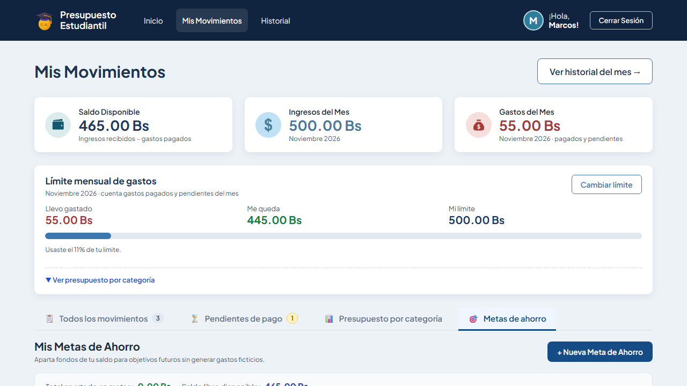
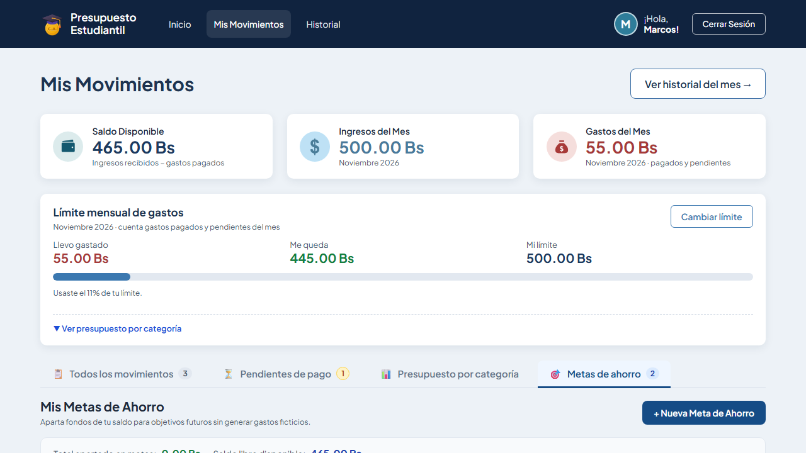
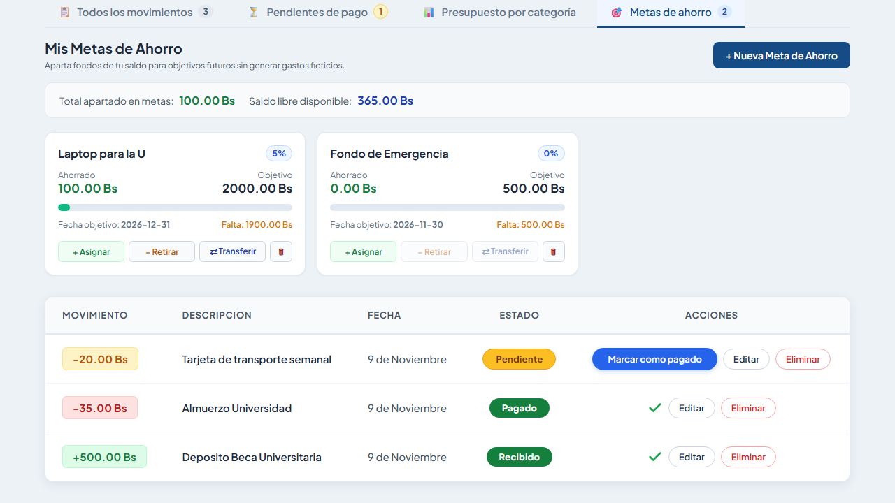
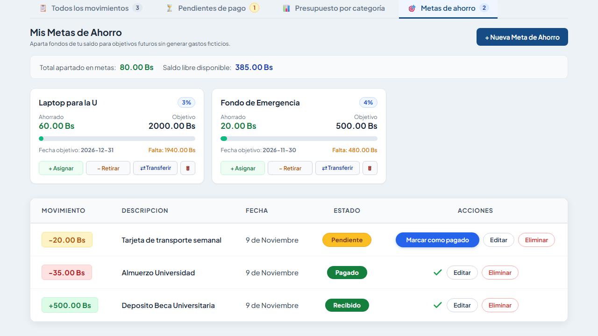
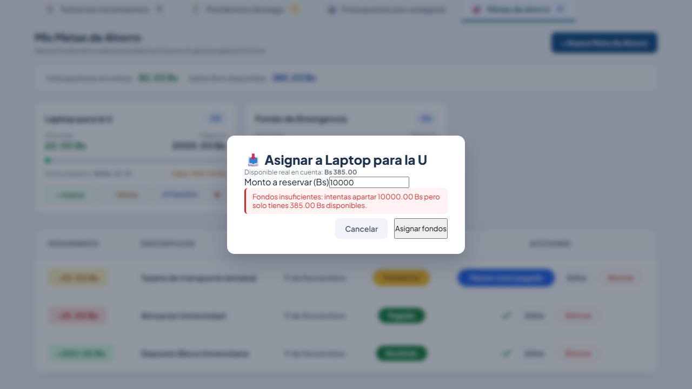

# Tarea 8 — Metas de Ahorro con Fondos Disponibles

**Materia:** Interacción Hombre-Computador (IHC)  
**Proyecto:** Presupuesto Estudiantil  
**Integrante:** Guzmán Montalvan Marcos Lehonti  
**Fecha de Entrega:** Martes 10/11/2026, 18:00  
**Repositorio GitHub:** [https://github.com/MarcosLehonti/PROYECTO2-IHC.git](https://github.com/MarcosLehonti/PROYECTO2-IHC.git)  

---

## 1. Funcionalidad Implementada

Siguiendo las especificaciones de la **Tarea 8: Incremento del Producto (Metas de Ahorro con Fondos Disponibles)**, se diseñó e implementó un flujo completo con estados, consecuencias y persistencia en base de datos:

1. **Creación de Metas de Ahorro:**
   - Permite crear objetivos de ahorro definiendo: **Nombre**, **Monto objetivo** y **Fecha límite**.
2. **Asignación de Fondos desde el Saldo Disponible:**
   - El estudiante aparta dinero de su saldo disponible real para asignarlo a una meta específica.
3. **Retiro de Fondos:**
   - Permite liberar fondos acumulados en una meta para reintegrarlos al saldo disponible en cuenta.
4. **Transferencia Directa entre Metas:**
   - Permite trasladar fondos reservados de una meta de origen a una meta de destino sin alterar el saldo general disponible.
5. **Regla de Negocio de Saldo Disponible Real:**
   $$\text{Disponible Real} = \text{Ingresos Pagados} - \text{Gastos Pagados} - \text{Fondos Reservados en Metas}$$
6. **Integridad Contable:**
   - Asignar, retirar o transferir fondos **no crea ingresos ni gastos ficticios**. Los movimientos reales del historial se conservan inalterados.
7. **Control y Validación de Fondos (Restricción Obligatoria):**
   - Se rechazan intentos de asignación que superen el saldo disponible real (HTTP 400 con mensaje preventivo `"Fondos insuficientes"`).
   - Se rechazan retiros que superen el monto ahorrado en la meta.
   - Se rechazan transferencias si la meta origen no cuenta con fondos suficientes.

---

## 2. Decisiones de Diseño y Usabilidad (Clase 20)

Para evitar ruido visual y sobrecarga cognitiva, la interfaz sigue las heurísticas y patrones trabajados en clase:

- **Navegación por Propósito:** La funcionalidad está integrada dentro de una pestaña dedicada (`🎯 Metas de ahorro`) en la barra superior por propósito, con badge dinámico que muestra el total de metas activas.
- **Desglose en la Tarjeta de Saldo Principal:** La tarjeta de saldo de la vista principal ahora exhibe de forma transparente el desglose contable:  
  *Ejemplo:* `Bs 385.00 · (385.00 Bs libre · 80.00 Bs en metas)`.
- **Banner de Resumen Financiero:** Al entrar a la sección de metas, un banner limpio expone el *Total apartado en metas* y el *Saldo libre disponible*.
- **Estado Vacío Asistido (*Empty State*):** Si el estudiante no tiene metas, la pantalla muestra una ilustración, texto explicativo y un botón de acción principal para guiar la creación de su primera meta.
- **Tarjetas de Metas Claras y Predictibles:** Cada meta muestra porcentaje acumulado, barra de progreso con transición fluida, fechas límite, faltante por ahorrar y acciones directas contextualizadas (`+ Asignar`, `− Retirar`, `⇄ Transferir`, `🗑 Eliminar`).
- **Prevención de Errores y Feedback Coherente:** Los modales muestran previamente el saldo disponible o ahorrado, validan rangos y entregan mensajes de error legibles en rojo ante cualquier intento inválido.

---

## 3. Archivos Afectados

El incremento del producto abarcó todas las capas del sistema (`Interfaz → Reglas y permisos → Datos persistentes → E2E`):

### Backend (FastAPI + PostgreSQL)
- **`PRESUPUESTO ESTUDIANTIL/BACKEND/models.py`:** Modelo ORM `MetaAhorro` (tabla `metas_ahorro`) con clave foránea a `usuarios` (on delete cascade) y campos `nombre`, `monto_objetivo`, `monto_actual`, `fecha_limite`, `creado_en`. Relación en modelo `Usuario`.
- **`PRESUPUESTO ESTUDIANTIL/BACKEND/schemas.py`:** Esquemas Pydantic `MetaAhorroCreate`, `MetaAhorroUpdate`, `MetaAhorroOut`, `MetaOperacionFondos`, `MetaTransferencia` y `ResumenMetasOut`.
- **`PRESUPUESTO ESTUDIANTIL/BACKEND/routers/metas.py`:** Nuevo router REST con endpoints:
  - `GET /metas`: Lista metas y calcula `fondos_reservados` y `saldo_disponible_real`.
  - `POST /metas`: Crea meta con validación de montos positivos y fechas válidas.
  - `POST /metas/{id}/asignar`: Reserva saldo verificando que `disponible_real >= monto`.
  - `POST /metas/{id}/retirar`: Reintegra fondos al disponible validando `monto_actual >= monto`.
  - `POST /metas/transferir`: Mueve dinero entre dos metas sin alterar el disponible.
  - `DELETE /metas/{id}`: Elimina la meta y libera automáticamente los fondos reservados.
- **`PRESUPUESTO ESTUDIANTIL/BACKEND/routers/movimientos.py`:** Integración del cálculo de fondos reservados en el resumen financiero global.
- **`PRESUPUESTO ESTUDIANTIL/BACKEND/main.py`:** Registro del router `metas.router`.
- **`PRESUPUESTO ESTUDIANTIL/BACKEND/seed.py`:** Limpieza y preparación de datos iniciales repetibles para el usuario de prueba `marcos@gmail.com`.

### Frontend (Vue 3 + Vite)
- **`PRESUPUESTO ESTUDIANTIL/FRONTEND/src/views/MovimientosView.vue`:**
  - Pestaña `#tab-metas` con badge contador.
  - Vista de sección dedicada `seccion-metas-ahorro`.
  - Modales de interfaz: Crear meta, Asignar fondos, Retirar fondos y Transferir fondos.
  - Lógica reactiva en Composition API y llamadas al backend.
  - Estilos CSS completos para tarjetas, badges de estado, barras de progreso y modales.

### Pruebas E2E (Playwright)
- **`tests/tarea8-metas-ahorro.spec.js`:** Suite automatizada de pruebas end-to-end con capturas paso a paso.

---

## 4. Enlaces a Commits en GitHub

Todos los cambios fueron subidos al repositorio oficial en commits estructurados y progresivos:

| Commit | Descripción del Cambio | Enlace en GitHub |
| :--- | :--- | :--- |
| `3aeac9c` | Tarea-8: modificaciones en los modelos | [Ver commit](https://github.com/MarcosLehonti/PROYECTO2-IHC/commit/3aeac9c) |
| `cafcbf8` | Tarea-8: Esquemas | [Ver commit](https://github.com/MarcosLehonti/PROYECTO2-IHC/commit/cafcbf8) |
| `de125ba` | Tarea*: rutas | [Ver commit](https://github.com/MarcosLehonti/PROYECTO2-IHC/commit/de125ba) |
| `4360c38` | Tarea-8: rutas/metas | [Ver commit](https://github.com/MarcosLehonti/PROYECTO2-IHC/commit/4360c38) |
| `f46202b` | Tarea-8: backend completado | [Ver commit](https://github.com/MarcosLehonti/PROYECTO2-IHC/commit/f46202b) |
| `5df9a2e` | Tarea-8: frontend pestaña de metas de ahorro | [Ver commit](https://github.com/MarcosLehonti/PROYECTO2-IHC/commit/5df9a2e) |
| `4d9c517` | Tarea-8: Frontend | [Ver commit](https://github.com/MarcosLehonti/PROYECTO2-IHC/commit/4d9c517) |
| `d7e0ad4` | Tarea-8: frontend modales de interacción para metas de ahorro | [Ver commit](https://github.com/MarcosLehonti/PROYECTO2-IHC/commit/d7e0ad4) |
| `590aa6c` | Tarea-8: frontend completo (estilos y validaciones) | [Ver commit](https://github.com/MarcosLehonti/PROYECTO2-IHC/commit/590aa6c) |
| `36c2ca4` | Tarea-8: Pruebas E2E en Playwright y evidencias | [Ver commit](https://github.com/MarcosLehonti/PROYECTO2-IHC/commit/36c2ca4) |

---

## 5. Comando de Ejecución y Resultados de las Pruebas E2E

### Comando para ejecutar la prueba de la Tarea 8:
```powershell
pnpm exec playwright test tests/tarea8-metas-ahorro.spec.js
```

### Resultado de la prueba obligatoria:
```text
[global-setup] Sembrando base de datos con datos limpios…
[OK] Conexion exitosa a PostgreSQL
[*] Iniciando proceso de siembra de datos (Seed)...
  [i] Usuario actualizado: marcos@gmail.com
-----------------------------------------------------------------
[OK] Base de datos sembrada con exito.
Usuario de prueba:  marcos@gmail.com
Contrasena:         123456
Estado inicial cargado:
   - Ingresos:         500.00 Bs
   - Gastos del mes:   55.00 Bs (35.00 pagado + 20.00 pendiente)
   - Saldo disponible: 465.00 Bs
   - Limite mensual:   500.00 Bs
-----------------------------------------------------------------
[global-setup] Semilla aplicada correctamente.

Running 1 test using 1 worker

[1/1] [chromium] › tests\tarea8-metas-ahorro.spec.js:9:3 › Pruebas E2E - Tarea 8: Metas de Ahorro con Fondos Disponibles › Flujo completo de Metas de Ahorro: 2 creadas, 1 asignacion, 1 transferencia, 1 retiro y 1 intento fallido sin fondos
  1 passed (14.2s)
```

**Resultado de la suite:**
- **Pruebas ejecutadas:** 1
- **Pruebas aprobadas:** 1 (100% de éxito)
- **Fallos pendientes:** Ninguno (0 fallos pendientes).

---

## 6. Galería de Capturas de Evidencia

### 6.1. Vista inicial de la sección Metas de Ahorro
Acceso mediante la pestaña por propósito `🎯 Metas de ahorro`, mostrando el banner de resumen de fondos y el estado vacío guiado:  


---

### 6.2. Dos metas de ahorro creadas
Demostración de persistencia y renderizado de las 2 metas: **Laptop para la U** (Objetivo: 2000 Bs) y **Fondo de Emergencia** (Objetivo: 500 Bs):  


---

### 6.3. Asignación de 100 Bs a la primera meta
Se reservan 100 Bs para «Laptop para la U». El monto se refleja en la tarjeta con su barra de progreso y se descuenta del saldo disponible real:  


---

### 6.4. Transferencia de 40 Bs entre metas
Se transfieren 40 Bs directamente desde «Laptop para la U» hacia «Fondo de Emergencia». Ambos saldos se actualizan (`Laptop: 60 Bs`, `Emergencia: 40 Bs`) mientras que el disponible en cuenta permanece intacto:  


---

### 6.5. Retiro de 20 Bs devueltos al disponible
Se retiran 20 Bs de «Fondo de Emergencia» (quedando en 20 Bs), liberándolos de vuelta al saldo disponible real de la cuenta:  


---

### 6.6. Intento fallido sin fondos (Restricción de Negocio)
Intento de asignar 10,000 Bs (superando el saldo disponible real). El sistema rechaza la operación con código HTTP 400 y muestra el mensaje de error `Fondos insuficientes`, protegiendo la integridad del presupuesto:  


