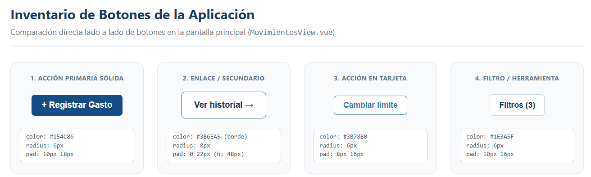

# Clase 23 : inventario y tokens

**Integrantes:** GUZMAN MONTALVAN MARCOS LEHONTI - SIN IA  
**Materia:** Interacción Hombre-Computador (IHC)  
**Fecha:** 2026-11-17  

---

## 1. INVENTARIO DE BOTONES

### Captura

### Ubicación de los botones en la pantalla principal (`MovimientosView.vue`)
- **1. Acción Primaria Sólida (`+ Registrar Gasto` / `.btn-new-mov`):** Barra superior de herramientas del Dashboard, a la derecha del input de búsqueda y los filtros.
- **2. Enlace / Acción Secundaria (`Ver historial →` / `.btn-historial`):** Cabecera principal del Dashboard, a la derecha del título "Mis Movimientos".
- **3. Acción en Tarjeta (`Cambiar límite` / `.btn-limite`):** Esquina superior derecha dentro de la tarjeta de "Límite mensual de gastos".
- **4. Filtro / Herramienta (`Filtros` / `.btn-filtros`):** Barra de búsqueda de movimientos, al lado del input de búsqueda.

### Inconsistencias Detectadas (Lo que debería ser igual y no lo es)

1. **Tonos de azul casi iguales pero diferentes:**
   - Se usan `#154C86` (fondo sólido en nuevo movimiento), `#3B78B0` (borde y texto en límite) y `#3B6EA5` (borde en historial) para el mismo rol de acción azul universitaria sin un token común.
   - **Problema:** Dispersión cromática: 3 azules distintos para la misma jerarquía.

2. **Border-radius dispares al azar:**
   - Unos botones tienen `border-radius: 6px` (`.btn-new-mov`, `.btn-limite`, `.btn-filtros`), mientras que otros usan `border-radius: 8px` (`.btn-historial` y botones de modales).
   - **Problema:** Geometría desigual: 6px vs 8px sin justificación estructural.

3. **Rellenos (padding) y alturas arbitrarias:**
   - `.btn-historial` fuerza `min-height: 48px` y un padding horizontal de `22px`.
   - `.btn-limite` usa `padding: 8px 16px`.
   - `.btn-new-mov` usa `padding: 10px 18px`.
   - **Problema:** Alturas dispares sin una escala de espaciado estandarizada.

4. **Estados que faltan (Accesibilidad):**
   - Ningún botón implementa `:focus-visible` accesible estandarizado con anillo de contraste para navegación por teclado.
   - `.btn-limite` carece de estado `:disabled` visual mientras se procesa la consulta con el servidor.
   - **Problema:** Falta `:focus-visible` accesible y feedback de deshabilitado.

---

## 2. CINCO TOKENS CON NOMBRE (NOMBRADOS POR USO, NO POR APARIENCIA)

> **Regla de tokens:** Cada valor se escribe una sola vez con un nombre semántico que indica *para qué sirve*. Los componentes usan el nombre del token, nunca el valor hardcodeado. Están nombrados por uso/propósito, no por apariencia (ejemplo: `color-accion-primaria` en lugar de `color-azul`, y `radio-borde-control` en lugar de `radio-8px`).

| Nombre del Token | Valor Claro (Light) | Valor Oscuro (Dark) | Dónde se usa en la aplicación |
| :--- | :--- | :--- | :--- |
| `color-accion-primaria` | `#154C86` | `#3B82F6` | Fondo del botón principal `+ Registrar Gasto`, botón `Guardar límite` y confirmaciones de modales. |
| `color-superficie-base` | `#FFFFFF` | `#1E293B` | Fondo de las tarjetas de resumen (`SummaryCard`), tarjeta de control de límite, contenedor de metas y fondo de modales. |
| `color-texto-principal` | `#1E293B` | `#F8FAFC` | Encabezados de página, nombres de transacciones en la tabla, títulos de modales y cifras cuantitativas principales. |
| `color-alerta-peligro` | `#DC2626` | `#EF4444` | Textos de advertencia por exceso de límite, mensajes de error en validaciones y botón de salida `Quitar límite`. |
| `radio-borde-control` | `8px` | `8px` | Radio de curvatura unificado para todos los botones interactivos, inputs de texto, selects y contenedores de formularios. |

---

## 3. CONTAR COLORES FIJOS (HARDCODED)

- **Pantalla revisada:** `PRESUPUESTO ESTUDIANTIL/FRONTEND/src/views/MovimientosView.vue` (Vista principal del Dashboard de Gestión de Gastos Estudiantiles).
- **Qué se buscó:** Todos los valores de color escritos directamente a mano (hardcoded) en la sección `<style>` del componente Vue mediante la búsqueda de patrones hexadecimales (`#[0-9a-fA-F]{3,8}`) y funciones de color `rgb(...)` / `rgba(...)`.
- **Resultados de la auditoría:**
  - **Total de colores fijos encontrados:** **286 declaraciones** escritas a mano.
  - **Colores únicos / diferentes encontrados:** **85 tonos distintos**.

### Distribución de los colores fijos más repetidos
| Cantidad | Color Hexadecimal / RGBA | Uso detectado en la pantalla |
| :---: | :--- | :--- |
| **25** | `#FFFFFF` | Fondos de tarjetas, tablas, modales y texto en botones primarios |
| **13** | `#1E293B` | Color de texto principal para títulos y cantidades |
| **13** | `#E2E8F0` | Bordes de tarjetas y divisores de tabla |
| **12** | `#3B78B0` | Azul utilizado en bordes y botones secundarios |
| **11** | `#64748B` | Color de texto secundario (etiquetas y fechas) |
| **9** | `#CBD5E1` | Bordes de inputs y botones de filtro |
| **8** | `#F8FAFC` | Fondo de filas alternadas y botones cancelar |
| **8** | `#15803D` | Verde para ingresos y transacciones pagadas |
| **7** | `#1E3350` | Azul oscuro usado en el botón de historial |
| **7** | `#3B6EA5` | Azul medio usado en el borde del historial |
| **7** | `#154C86` | Azul institucional usado en el botón nuevo movimiento |
| **7** | `#DC2626` | Rojo usado para montos de gastos y alertas |
| **7** | `#B91C1C` | Rojo oscuro duplicado para advertencias de límite |
| **5** | `#A63A3A` | Tercer tono de rojo diferente usado en alertas |

### Diagnóstico de la pantalla
La presencia de **286 colores hardcodeados** y **85 variantes distintas** (con 4 tonos de azul y 3 tonos de rojo sin jerarquía clara) demuestra que la interfaz sufre de alta dispersión cromática por falta de tokens, lo cual dificulta el mantenimiento e imposibilita aplicar un modo oscuro de forma limpia.
