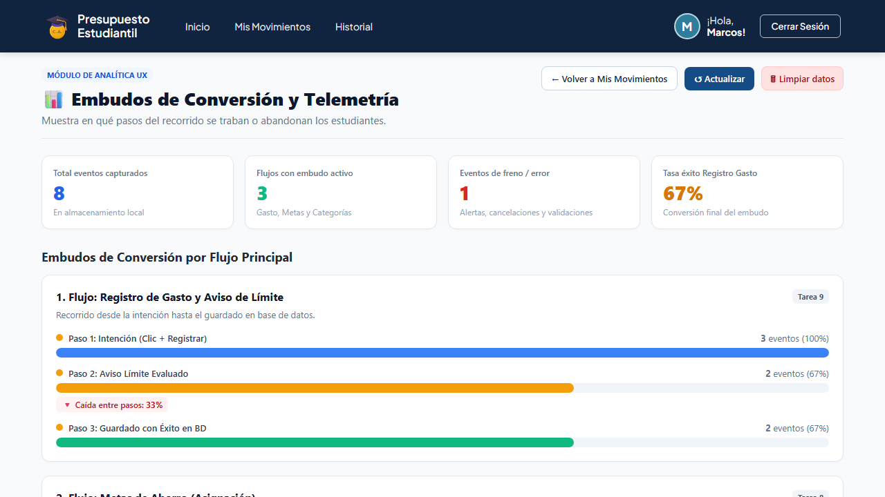
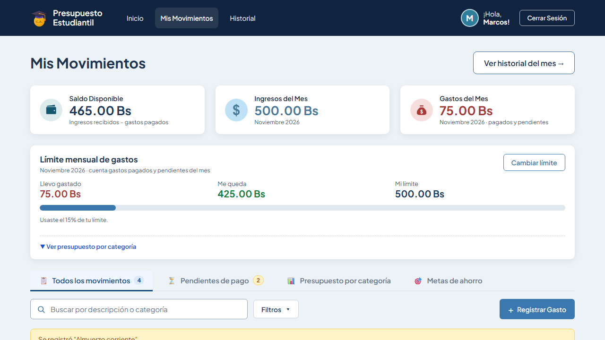
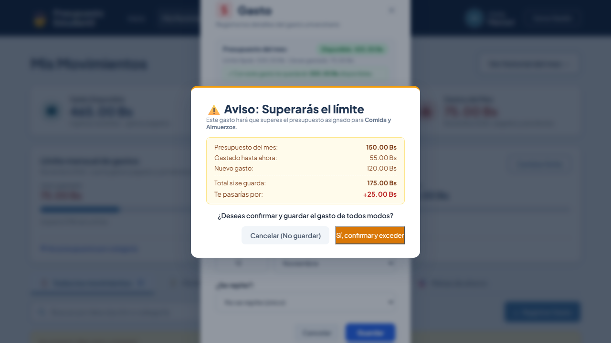
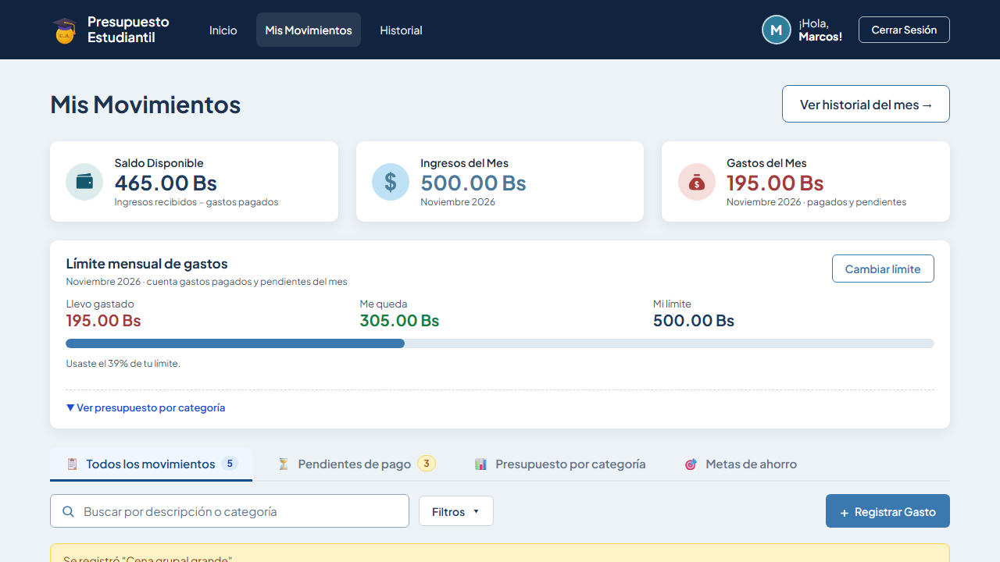
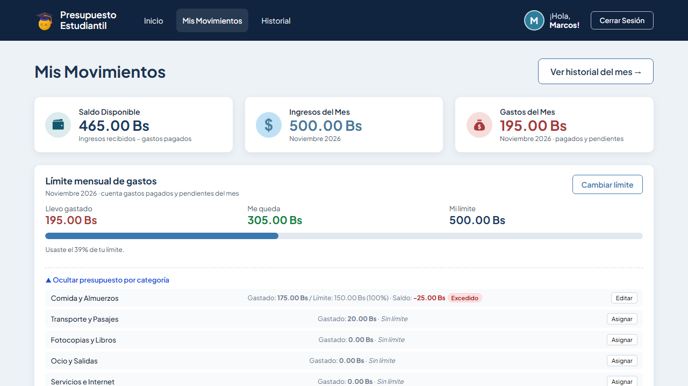

# Tarea 9 — Telemetría Extendida, Embudos de Conversión y Aviso de Límite

**Integrante:** Guzmán Montalvan Marcos Lehonti  
**Fecha:** 2026-11-12  
**Repositorio:** https://github.com/MarcosLehonti/PROYECTO2-IHC

---

## Parte A — Telemetría Extendida y Panel de Embudos

### Descripción

Se extendió el sistema de telemetría (`track(evento, props)` sobre `localStorage`) a **todos los flujos principales** de la aplicación, 100% en el frontend sin tocar el backend. Se creó además la vista `/analitica` que muestra un embudo de conversión por flujo, tasas de caída entre pasos, puntos de freno y el registro cronológico de eventos.

### App Map con marcadores de eventos

```
Inicio (/login)
  🟡 inicio → presupuesto_movimiento_iniciado
  🟡 éxito  → presupuesto_movimiento_guardado
  🔴 error  → presupuesto_gasto_error_validacion

Flujo Gasto
  🟡 inicio → presupuesto_movimiento_iniciado
     ↓
  🟡 aviso  → presupuesto_limite_advertido  (si supera categoría)
     ↓
  🟡 éxito  → presupuesto_movimiento_guardado
  🔴 error  → presupuesto_gasto_error_validacion
  🔴 cancel → presupuesto_gasto_cancelado_limite

Flujo Meta de Ahorro
  🟡 inicio → presupuesto_meta_creacion_iniciada
  🟡 éxito  → presupuesto_meta_creada
  🟡 inicio → presupuesto_meta_asignacion_iniciada
  🟡 éxito  → presupuesto_meta_fondos_asignados
  🔴 error  → presupuesto_meta_error_fondos
  🟡 éxito  → presupuesto_meta_retiro_realizado
  🟡 éxito  → presupuesto_meta_transferencia_realizada

Flujo Categoría
  🟡 inicio → presupuesto_categoria_asignacion_iniciada
  🟡 éxito  → presupuesto_categoria_guardado

Búsqueda / Filtros
  🟡 acción → presupuesto_filtro_aplicado
  🔴 freno  → presupuesto_busqueda_sin_resultados
```

> 🟡 = evento de inicio o éxito | 🔴 = evento de error, validación fallida o freno al flujo

---

### Plan de Eventos

| Evento | Flujo | Archivo: línea (aprox.) | Pregunta que responde |
|--------|-------|------------------------|----------------------|
| `presupuesto_movimiento_iniciado` | Gasto | `MovimientosView.vue:1884` | ¿Cuántos usuarios intentan registrar un gasto? |
| `presupuesto_movimiento_guardado` | Gasto | `MovimientosView.vue:1977` | ¿Cuántos gastos se guardan con éxito? |
| `presupuesto_gasto_error_validacion` | Gasto | `MovimientosView.vue:1890,1895` | ¿En qué campos falla la validación? |
| `presupuesto_limite_advertido` | Gasto | `MovimientosView.vue:1926` | ¿Cuántas veces se muestra el aviso de límite? |
| `presupuesto_gasto_cancelado_limite` | Gasto | `MovimientosView.vue:1861` | ¿Cuántos usuarios cancelan al ver el aviso? |
| `presupuesto_meta_creacion_iniciada` | Meta | `MovimientosView.vue` | ¿Cuántos usuarios intentan crear una meta? |
| `presupuesto_meta_creada` | Meta | `MovimientosView.vue` | ¿Cuántas metas se crean con éxito? |
| `presupuesto_meta_asignacion_iniciada` | Meta | `MovimientosView.vue` | ¿Cuántos asignan fondos a una meta? |
| `presupuesto_meta_fondos_asignados` | Meta | `MovimientosView.vue` | ¿Con qué frecuencia se asignan fondos? |
| `presupuesto_meta_error_fondos` | Meta | `MovimientosView.vue` | ¿Cuándo fallan los fondos y por qué? |
| `presupuesto_meta_retiro_realizado` | Meta | `MovimientosView.vue` | ¿Cuántos usuarios retiran fondos de metas? |
| `presupuesto_meta_transferencia_realizada` | Meta | `MovimientosView.vue` | ¿Cuántas transferencias entre metas hay? |
| `presupuesto_categoria_asignacion_iniciada` | Categoría | `MovimientosView.vue` | ¿Cuántos asignan presupuesto por categoría? |
| `presupuesto_categoria_guardado` | Categoría | `MovimientosView.vue` | ¿Cuántos guardan el presupuesto correctamente? |
| `presupuesto_filtro_aplicado` | Filtros | `MovimientosView.vue` | ¿Qué filtros usan más los usuarios? |
| `presupuesto_busqueda_sin_resultados` | Búsqueda | `MovimientosView.vue` | ¿Cuántas búsquedas no encuentran nada? |

---

### Panel `/analitica` — Embudos de Conversión

La vista `AnaliticaView.vue` en `/analitica` muestra:

- **3 embudos** (Gasto, Meta de Ahorro, Categoría) con tasa de conversión por paso
- **Tabla de puntos de freno** con motivo, flujo y recuento
- **Registro cronológico** de todos los eventos registrados en la sesión

**Captura 6 — Panel de embudos:**


**Captura 7 — Frenos y eventos:**


---

## Parte B — Aviso antes de Superar el Límite de Categoría

### Descripción

Cuando el usuario intenta guardar un **gasto** (`tipo === 'gasto'`) y el monto haría que la suma `gastado_categoria + nuevo_monto > limite_categoria`, se muestra un **modal de aviso** (`modal-aviso-limite`) con:

- Presupuesto del mes asignado
- Gastado hasta ahora
- Nuevo gasto que se quiere guardar
- Total si se guardara
- **Cuánto se pasaría** (en rojo, con el signo `+`)
- Botón **Cancelar (No guardar)** → no cambia nada
- Botón **Sí, confirmar y exceder** → guarda y la categoría queda en estado `Excedido`

Los **ingresos nunca generan aviso**.

### Implementación

- `calcularExcesoCategoria()` en `MovimientosView.vue` calcula el exceso comparando el límite del backend con la suma local de gastos del mes en esa categoría.
- Se llama dentro de `guardarGastoEstudiantil()` y `guardarEdicion()` antes del `fetch` POST/PUT.
- El flag `confirmadoExceso` permite que la segunda llamada (tras confirmar) salte el chequeo.

---

### Demostración con 3 casos

**Datos de partida (seed limpio):**
- Categoría "Comida y Almuerzos" → límite 150.00 Bs, gastado 55.00 Bs

---

#### Caso 1: Gasto de 20 Bs — SIN aviso (dentro del límite)

55 + 20 = 75 Bs ≤ 150 Bs → se guarda directamente, sin modal.



---

#### Caso 2: Gasto de 120 Bs — CON aviso, CANCELADO (todo queda igual)

75 + 120 = 195 Bs > 150 Bs → se muestra el aviso con exceso de +45.00 Bs.  
El usuario cancela → el gasto **NO se guarda**, la lista queda sin cambios.




---

#### Caso 3: Gasto de 120 Bs — CON aviso, CONFIRMADO (queda excedido)

El usuario confirma → el gasto se guarda y la categoría pasa a estado **Excedido** (badge rojo).





---

## Pruebas E2E — Playwright

### Resultado

```
Running 1 test using 1 worker

[1/1] [chromium] tests/tarea9-aviso-limite-y-telemetria.spec.js
  ✅ Caso 1: Gasto de 20 Bs guardado sin aviso
  ✅ Caso 2: Aviso cancelado, gasto NO guardado
  ✅ Caso 3: Aviso confirmado, categoría en estado Excedido
  ✅ Caso 4: Panel /analitica con embudos visible y correcto

  1 passed (31.2s)
```

### Archivo de prueba

`tests/tarea9-aviso-limite-y-telemetria.spec.js`

Cubre:
1. Gasto sin aviso (20 Bs, dentro del límite)
2. Aviso mostrado y cancelado — `not.toContainText('Cena grupal grande')` verifica que no se guardó
3. Aviso confirmado — `badge-cat-excedido` visible en "Comida y Almuerzos"
4. Panel `/analitica` — `.analitica-titulo`, 3 `.card-embudo`, `.seccion-frenos`, `.tabla-telemetria`

